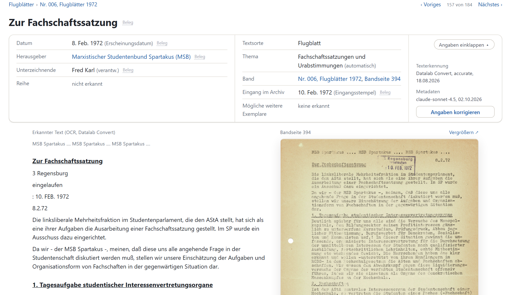

# UR Leaflet Archive

*English: This repository makes the general leaflet collection of the Regensburg University Archives (Rep. 118, student movement, 1967–1973) searchable. It contains a web application with 1927 scanned leaflet copies, their recognized text and metadata, the tools to add further volumes, and the project report. It was built in a project seminar at the University of Regensburg in summer 2026; the documentation is in German.*

Die Allgemeine Flugblattsammlung des Universitätsarchivs Regensburg (Rep. 118) enthält Flugblätter aus der Studentenbewegung der Jahre 1967 bis 1973. Dieses Repository macht sie durchsuchbar: 1927 Exemplare aus 14 Bänden mit Scan, erkanntem Text, Titel, Datum, Herausgebern und Thema. Es entstand in einem Praxisseminar im Sommersemester 2026 und enthält die Anwendung, den Projektbericht und die Werkzeuge, mit denen weitere Bände eingelesen werden.



## Schnellstart

Sie brauchen Docker und zwei Ordner nebeneinander. Konfigurieren müssen Sie nichts.

**1. Docker installieren** (einmalig)

| System | Installieren |
|---|---|
| Windows 10 oder 11 | [Docker Desktop für Windows](https://docs.docker.com/desktop/setup/install/windows-install/). Das Installationsprogramm richtet WSL 2 mit ein. Starten Sie den Rechner neu, wenn es danach fragt. |
| macOS | [Docker Desktop für Mac](https://docs.docker.com/desktop/setup/install/mac-install/), die Fassung für Apple-Chip oder für Intel (Apfelmenü › Über diesen Mac). |
| Linux | [Docker Engine](https://docs.docker.com/engine/install/) mit dem Compose-Plugin (Paket `docker-compose-plugin`). |

Unter Windows und macOS muss Docker Desktop laufen, bevor Sie weitermachen. Das Wal-Symbol in der Taskleiste oder Menüleiste zeigt das an.

**2. Die beiden Ordner ablegen**

Legen Sie den Code und den Datenordner aus Drive in denselben Ordner, etwa `Flugblattsammlung`:

```
Flugblattsammlung/
├── UR_LeafletArchive/         der Code (dieses Repository)
└── UR_LeafletArchive_data/    Scans und Texterkennung, aus Drive
```

`UR_LeafletArchive_data.zip` aus Drive entpacken Sie direkt in `Flugblattsammlung`. Prüfen Sie danach, dass in `UR_LeafletArchive_data` unmittelbar die Ordner `Nr. 001 (1967)` bis `Nr. 015 (1973)` liegen und nicht noch ein Ordner dazwischen.

**3. Starten**

Öffnen Sie ein Terminal im Ordner `UR_LeafletArchive`:

- Windows: im Explorer Rechtsklick auf den Ordner › „Im Terminal öffnen“.
- macOS: Terminal öffnen, `cd ` (mit Leerzeichen) tippen, den Ordner aus dem Finder ins Fenster ziehen, Enter.
- Linux: `cd` in den Ordner.

Dann:

```bash
docker compose up -d
```

Unter Linux ohne Docker-Gruppe mit `sudo` davor. Der erste Start dauert 10 bis 20 Minuten: Docker lädt und baut das Image (etwa 1,5 GB), die Anwendung legt ihre Datenbank an. Auf einem Mac mit Apple-Chip läuft das Image emuliert und ist etwas langsamer.

**4. Öffnen**

http://localhost:8000/ im Browser. Die Vorschaubilder entstehen in den ersten Minuten im Hintergrund. Oben rechts führt „Doku“ zu Projektbericht und Handbüchern.

Stimmt am Datenordner etwas nicht, zeigt die Anwendung oben auf jeder Seite einen Hinweis, was fehlt. Die Anwendung startet mit Docker von selbst wieder, auch nach einem Neustart des Rechners. Anhalten mit `docker compose stop`, wieder starten mit `docker compose up -d`.

Liegt der Datenordner woanders, kopieren Sie `.env.example` nach `.env` und tragen dort den Pfad ein. Nach einem Update des Repositorys steht in [`docs/handbuch/installieren-und-betreiben.md`](docs/handbuch/installieren-und-betreiben.md#installation), ob neu gebaut oder die Datenbank neu angelegt werden muss.

Die Anwendung hat keine Anmeldung und ist deshalb nur auf dem eigenen Rechner erreichbar. Wie sie auf einem Server mit Passwort läuft, steht in [`docs/handbuch/installieren-und-betreiben.md`](docs/handbuch/installieren-und-betreiben.md).

## Was die Anwendung kann

Die Anwendung durchsucht den ganzen Text und zeigt die Fundstellen. Die Treffer lassen sich nach Jahr, Herausgeber, Thema und Textsorte filtern; dazu kommen Trends über die Jahre und eigene Seiten für Themen, Organisationen und Bände. Jedes Flugblatt zeigt Scan und Text nebeneinander, jede Angabe mit ihrem Beleg im Text.

Metadaten lassen sich von Hand korrigieren, Mehrfachexemplare prüfen und der Bestand als ZIP exportieren ([Anleitung](docs/handbuch/pflegen.md)). Neue Bände kommen in sechs Schritten von den Scans bis zur Freigabe dazu, im Browser oder in der Kommandozeile ([Anleitung](docs/handbuch/neue-baende-importieren.md)).

## Aufbau

```
data/           Quelle der Datenbank: Metadaten je Band, Korrekturen, Register, Themen
docs/           Projektbericht, Handbücher, Glossar (MkDocs)
scripts/        Werkzeuge neben der Anwendung: Textauswertung, Scans, Abbildungen, Bericht als PDF
src/backend/    Anwendung (FastAPI, SQLite), Import, Tests
src/frontend/   Templates, Stylesheets, Skripte im Browser
```

Die Dateien in `data/` sind maßgeblich und gehören ins Repository; die Datenbank wird aus ihnen gebaut. Scans und Texterkennung liegen wegen ihrer Größe im Datenordner außerhalb:

```
UR_LeafletArchive_data/
├── Nr. 001 (1967)/
│   ├── 0118_0001.pdf               # Scan des Bandes
│   ├── 0118_0001.segments.json     # wo ein Flugblatt endet
│   └── 0118_0001/
│       ├── 0118_0001.json          # Texterkennung (Datalab)
│       └── <hash>_img.jpg          # Abbildungen aus der Texterkennung
├── Nr. 002 (1968)/
└── …
```

Ohne Datenordner startet die Anwendung trotzdem, zeigt dann aber weder Scans noch Text.

## Dokumentation

Der Projektbericht und die Lesepfade für Archiv, Forschung und Entwicklung beginnen in [`docs/README.md`](docs/README.md). Code, Datenformate und Tests beschreibt [`docs/handbuch/weiterentwickeln.md`](docs/handbuch/weiterentwickeln.md), die Werkzeuge neben der Anwendung [`scripts/README.md`](scripts/README.md).

Als Website ist die Dokumentation in der laufenden Anwendung unter http://localhost:8000/doku/ zu lesen. Wie man sie beim Schreiben als Vorschau startet, steht in [`weiterentwickeln.md`](docs/handbuch/weiterentwickeln.md).

Das Arbeits-Repository des Projekts mit der Evaluation der Texterkennung und den ersten Metadatenläufen ist archiviert: https://github.com/Alphazerfall/flugblatt_praxisseminarSS26

## Lizenz

MIT, siehe [`LICENSE`](LICENSE).
