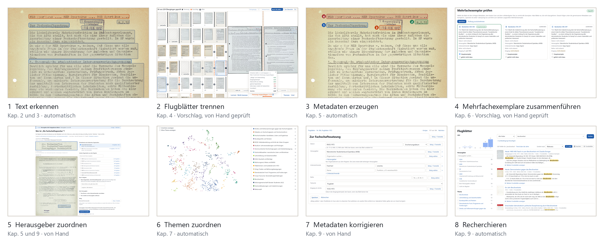

# 1 Einleitung

Das Projekt begann mit einer ersten Besprechung mit Professor Wolff und unserem Projektbetreuer Thomas Schmidt am 12.05.2026. In dieser Besprechung wurde uns von Professor Wolff eine erste Einleitung in das Thema gegeben. So wurden wir über die geschichtlichen Hintergründe (die im Folgenden erläutert werden) informiert, und es wurde die Schaffung eines digitalen Flugblattarchivs als Projektziel diskutiert. Zu diesem Termin wurde auch gleich das erste Dokumentationsobjekt geschaffen, ein Google Docs Dokument, in dem fortan wichtige Inhalte aller Besprechungen und generell relevante Informationen für das Projekt festgehalten wurden. Sämtliche weiteren Informationen zur Projektorganisation befinden sich im Kapitel 12.

Im nächsten Treffen am 20.05.2026 durften wir Herrn Dr. Andreas Becker kennenlernen, dieser war für die Dauer unseres Projekts unser Ansprechpartner zum Archiv. In dieser Besprechung erhielten wir von Herrn Becker eine spannende und detaillierte Einführung über die historische Entstehung der Flugblattsammlung im Archiv und die geschichtlichen und politischen Hintergründe der Anfangszeit der Universität Regensburg.

## 1.1 Motivation und Ausgangslage

Das Regensburger Universitätsarchiv verfügt über eine ausgedehnte Flugblattsammlung, vom Archiv einfach als Repositorium 118 nummeriert. Diese sogenannte Allgemeine Flugblattsammlung bewahrt, was Studierende, Hochschulgruppen, Parteien, Unternehmen oder andere Akteure zwischen 1967 und 1973 selbst geschrieben, vervielfältigt und verteilt haben: Aufrufe zu Streiks und Vollversammlungen, Wahlprogramme, Stellungnahmen, Satire, Werbung, Einladungen und vieles mehr. Die Vielfältigkeit dieser Sammlung lässt sich nur schwer beschreiben, und auch die Informationen, die sich in diesen verblichenen Texten befinden. 

Regensburg war damals eine junge Universität, der Vorlesungsbetrieb begann am 6. November 1967. Harte Auseinandersetzungen im Sinne der 68er-Bewegung gab es zunächst nicht. Scharfe Proteste mit Massendemonstrationen setzten erst ein, als bekannt wurde, dass der Freistaat mit dem neuen Bayerischen Hochschulgesetz die Drittelparität in den Gremien und die verfasste Studierendenschaft abschaffen wollte. Andreas Becker nennt die Jahre 1971 bis 1973 in seinem Lexikonartikel „die eigentlich revolutionäre Zeit“ der Universität, auch wegen der Wahl des Physikers Gustav Obermair zum Rektor, der damals als Marxist verschrien war [@becker2021]. Dieses Hochschulgesetz lässt sich in vielen Flugblättern wiedererkennen und stellt eines der zentralen Themen im damaligen hochschulpolitischen Diskurs.

Jedoch ist das Bayerische Hochschulgesetz (BHG) nicht nur das einzige Thema, dass sich über die Geschichte Regensburg in dieser Sammlung finden lässt. Man kann die Anfänge noch heute bestehender Hochschulgruppen nachvollziehen, man erhält Einblick in den Beginn Regensburgs Nachtleben als Studentenstadt, man kann das damalige politische Engagement bekannter Namen ermitteln oder man befasst sich mit der damaligen (Jugend-)Sprache. 

Das zeigt, wie reichhaltig diese Sammlung überhaupt ist, doch sind bisher diese ganzen Texte und Flugblätter nur im Magazin des Universitätsarchivs gelegen, verpackt in Kartons und durchnummeriert. Im Herbst 2025 wurde dann seitens des Universitätsarchivs begonnen, diese Flugblätter zu digitalisieren. Bis zum Beginn dieses Projekts im Sommer 2026 wurden 4464 Seiten als Fotos digitalisiert. Es gab keinen Volltext, keine Grenzen zwischen den Flugblättern und keine Angaben zu Titel, Datum oder Herausgeber. Wollte man beispielsweise wissen, welche Gruppen sich zum Hochschulgesetz äußerten, musste die Bände Seite für Seite durchsehen. Heute benötigt dieser Prozess wenige Sekunden, ein Wählen der Suchparameter und ein Klick des entsprechenden Buttons, und die dadurch erwirkte Suche in der 1547 Flugblätter beinhaltenden Datenbank bringt sofort 304 Flugblätter von 71 verschiedenen Herausgebern.

Andere Universitäten haben ihre Flugblätter aus dieser Zeit ebenfalls digitalisiert. Die TU Berlin zeigt rund 1800 Flugblätter der Jahre 1965 bis 1972 in Kitodo, mit Volltextsuche [@tub-flugblaetter]. In Frankfurt verzeichnet eine private Sammlung 403 Flugblätter von 1967 bis 1969 von Hand nach Datum, Urheber, Thema und Art [@frankfurt-flugblaetter]. Die Sammlung der Universität Hamburg mit über zehntausend Flugblättern ist nach Anton F. Guhl und Alexandra Jaeger kaum erschlossen [@hamburg-flugblaetter]. Eine Flugblattsammlung einer deutschen Universität, die ähnlich automatisch erschlossen wird und die das Archiv selbst fortführen kann, ist nicht bekannt (Stand Oktober 2026).

Guhl und Jaeger nennen für die Hamburger Sammlung drei Hürden, die auch in Regensburg bestehen:

| Hürde nach Guhl und Jaeger | Arbeitsschritt | Stand in Regensburg |
|---|---|---|
| Dubletten machen die Zahl der Flugblätter unsicher | Mehrfachexemplare zusammenführen (Kap. 6) | 1 927 Exemplare ergeben 1 547 Flugblätter |
| Viele Blätter nennen keine Verantwortlichen | Herausgeber mit Beleg und Register (Kap. 5) | 241 Flugblätter bleiben ohne erkannten Herausgeber |
| Ohne Parallelüberlieferung ist das Datieren schwer | Datum mit Beleg, sonst Jahr des Bandes (Kap. 5) | 46 % tragen ein Datum auf dem Blatt |

Der größte Teil dieser Arbeit läuft mithilfe dieses Projekts automatisch (Kap. 3 bis 7). Für jeden Wert, den das Sprachmodell ausliest, nennt es die Textstelle, auf die er sich stützt, so lässt sich jede Angabe am Scan nachprüfen. Von Hand bestätigt ein Mensch nur die Grenzen zwischen den Flugblättern (das mittlerweile auch mit Unterstützung automatisierter Systeme) und die Gruppen von Mehrfachexemplaren. Texterkennung und Metadaten kosten zusammen rund 18 $ je 1000 Seiten (hochgerechnet, Kap. 11), und neue Bände liest das Archiv in der Anwendung selbst ein (Kap. 9).

*Abbildung: Der Weg eines Flugblatts durch die Arbeitsschritte, am Beispiel von Flugblatt 850 („Zur Fachschaftssatzung“, Band 006, S. 394). Trennen und Mehrfachexemplare sind Vorschläge, die von Hand geprüft werden; die übrigen Schritte laufen automatisch.*

## 1.2 Ziele

Das Hauptziel des Projekts ist die Schaffung eines durchsuchbaren Korpus auf Basis der Allgemeinen Flugblattsammlung des Archivs der Universität Regensburg. Die Durchsuchbarkeit des Korpus wird durch ein leicht nutzbares Webinterface ermöglicht, das verschiedene Such-, Filter- und Visualisierungsfunktionen bereitstellt. Zudem ist eine langfristige Nutzbarkeit der Anwendung gewährleistet, indem die im Laufe der Digitalisierung neu anfallenden Flugblätter leicht in die bestehende digitale Sammlung eingepflegt werden können.

## 1.3 Projekt

Das Projekt entstand an der Universität Regensburg im Praxisseminar des M.Sc. Medieninformatik im Sommersemester 2026. Ansprechpartner des Universitätsarchiv war Dr. Andreas Becker. Organisation, Verlauf und die wichtigsten Entscheidungen beschreibt Kapitel 12.