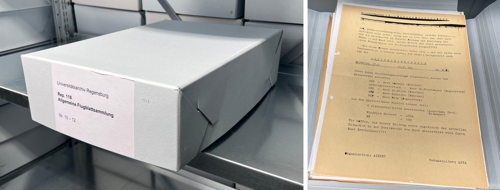

# 2 Der Bestand

Bevor wir Text erkennen konnten, mussten wir festlegen, welche Flugblätter das Korpus bilden und in welcher Form sie vorliegen. Am Ende stand ein Bestand von 4464 Seiten aus 14 Bänden der Jahre 1967–1973.

## 2.1 Korpuswahl

Ursprünglich wollten wir das Korpus aus einer anderen Sammlung bilden, der Sammlung Reisner. Sie entstand zur selben Zeit wie die Allgemeine Flugblattsammlung, ist aber nicht digitalisiert; das hätte viele Stunden oder Tage gekostet. Außerdem enthält sie nur Flugblätter links orientierter Hochschulgruppen. Weil rechte Gegenstimmen fehlen, dokumentiert sie die politischen Auseinandersetzungen jener Zeit nicht repräsentativ. In der ersten Besprechung mit Andreas Becker am 20.05.2026 haben wir deshalb festgelegt, die Allgemeine Flugblattsammlung zu nehmen, die schon teilweise digitalisiert war. Eine weitere Flugblattsammlung des Archivs liegt im Privatarchiv Jörg Wiesner (Rep. 113, Teil „Flugblattsammlung“, [Archivrecherche](https://archivrecherche.uni-regensburg.de/archive.xhtml)). Sie umfasst 12 Einheiten aus den Jahren 1970 bis 1987, davon nur drei aus unserem Zeitraum (Flugblätter 1970/71, 1973 und der Fachschaften 1970–1972); den Rest haben wir nicht untersucht.

## 2.2 Das Korpus und dessen Gliederung

Das Korpus umfasst die Jahrgänge 1967 bis 1973 der Allgemeinen Flugblattsammlung der Universität Regensburg (Universitätsarchiv, Rep. 118). Die Universitätsbibliothek legte die Sammlung 1968 an und übergab sie 2004 an das Universitätsarchiv. Verzeichnet wurde sie 2007, 2008 und 2011. 2008 kamen 23 Ordner Flugschriften der Jahre 1967–1995 vom Studentenwerk hinzu und wurden einsortiert [@uar-rep118]. Heute wächst die Sammlung kaum noch, weil Gruppen soziale Medien nutzen und das freie Aushängen inzwischen geregelt ist [@uar-rep118].

Gegliedert ist das Korpus nach Jahrgängen und Bänden. Die 7 Jahrgänge liegen im Archiv in Kartons; große Jahrgänge verteilen sich auf mehrere Kartons und Bände. Der Karton „Nr. 10–12“ etwa enthält drei Bände von 1973. Innerhalb eines Jahrgangs sind manche Bände nach Gruppen sortiert: Nach dem Findmittel enthalten die Bände 007 (RCDS), 011 (Demokratische Front) und 013 (AStA) überwiegend Blätter je einer Gruppe. Zu jedem der 14 Bände gibt es eine PDF-Datei. Zusammen sind es 4464 Seiten und rund 1,06 Millionen Token Volltext.

*Abbildung: Karton „Rep. 118, Nr. 10–12“ mit der Aufschrift 1973 und Flugblatt 1492 im Original (Band 012). Lochung am linken Rand und farbiges Papier sind auch auf dem Scan zu sehen.*

Weil viele Flugblätter mehrere Seiten haben, ergeben diese Seiten 1547 Flugblätter (Stand 17.10.2026, Mehrfachexemplare zusammengefasst). Den größten Teil machen politische Flugblätter aus, daneben Einladungen, Broschüren, offene Briefe und Zeitschriften. Herausgeber sind der AStA, die politischen Hochschulgruppen (u. a. RCDS, MSB Spartakus, SHB, Demokratische Front), Fachschaften, Studentenverbindungen und die Hochschulleitung, insgesamt rund 170. Thematisch dominieren Hochschulpolitik und das Bayerische Hochschulgesetz, Hochschulwahlen und Streiks; hinzu kommen bundespolitische und internationale Themen. Diese Angaben stammen aus der automatischen Erschließung und sind entsprechend ungenau; Zahlen mit Zählregeln stehen in Kap. 8.

Über die Jahre ist der Bestand ungleich verteilt. 70 % der Seiten stammen aus 1972 und 1973, für 1967 liegen nur 13 Seiten mit 6 Flugblättern vor (Band 001). Das spiegelt die Geschichte der Universität (Kap. 1.1): Der Vorlesungsbetrieb begann erst Ende 1967, und die Proteste gegen das neue Hochschulgesetz prägten vor allem die Jahre 1971 bis 1973 [@becker2021]. Was im Bestand fehlt, beschreibt Kap. 2.5.

Die meisten Flugblätter sind mit der Schreibmaschine geschrieben, weil die Gruppen sie selbst vervielfältigten; rund 230 tragen die Aufschrift „Eigendruck im Selbstverlag“. Einzelne Blätter stammen aus Druckereien.

| Band | Jahr | Seiten | Exemplare | Flugblätter |
|---|---|---|---|---|
| 001 | 1967 | 13 | 6 | 6 |
| 002 | 1968 | 85 | 58 | 51 |
| 003 | 1969 | 317 | 212 | 184 |
| 004 | 1970 | 294 | 187 | 169 |
| 005 | 1971 | 629 | 230 | 196 |
| 006 | 1972 | 455 | 184 | 143 |
| 007 | 1972 | 223 | 69 | 43 |
| 008 | 1972 | 325 | 144 | 94 |
| 009 | 1972 | 605 | 234 | 197 |
| 010 | 1973 | 217 | 75 | 60 |
| 011 | 1973 | 255 | 92 | 58 |
| 012 | 1973 | 286 | 131 | 100 |
| 013 | 1973 | 261 | 137 | 104 |
| 014 | 1973 | 499 | 168 | 142 |
| **Summe** |  | **4464** | **1927** | **1547** |

In der Spalte „Exemplare“ zählt jedes Exemplar einzeln, in der Spalte „Flugblätter“ zählen Mehrfachexemplare einmal (Kap. 6).

## 2.3 Sammlung und Digitalisierung

Wie die Flugblätter gesammelt wurden, ist auf den Scans sichtbar und hilft später beim Trennen und Datieren. Mitarbeitende der Universität sammelten die Flugblätter, lochten sie und hefteten sie in Ordnern ab, bis 2006. Ab 1969 und bis 2007 erhielten viele Flugblätter auf der Vorderseite einen Stempel mit dem Datum des Eingangs, einen Anhaltspunkt für die Zeit, in der sie erschienen [@uar-rep118]. Die Löcher sind am linken Rand der Vorderseite oder am rechten Rand der Rückseite zu sehen. Die Eingangsstempel („eingelaufen“) erkennt die Auswertung ab dem Jahrgang 1969: in Band 003 bei 8 von 212 Exemplaren, in den Bänden ab 1970 bei 13 bis 32 % (nach den Korrekturen von Hand, Kap. 5).

Digitalisiert hat das Archiv die Flugblätter mit einer Kamera über dem Blatt. Ein Flachbettscanner kam nicht in Frage, weil die Blätter in Form und Format zu verschieden und über die Jahre oft brüchig geworden sind. Je Band entstand eine PDF-Datei, zusammen rund 9,2 GB. Die Dateien heißen `0118_0001.pdf` bis `0118_0014.pdf` (Rep. 118, Band), die Anwendung zeigt sie beispielsweise als „Nr. 001 (1967)“. Jede Seite ist ein farbiges JPEG-Bild ohne Textebene. Die Auflösung, bezogen auf die in den PDFs angegebene Seitengröße von etwa A4, ist nicht einheitlich: Band 001 und 002 haben 300 dpi (1787 × 2479 Pixel), die Bände 003 bis 012 überwiegend 600 dpi (4912 × rund 6970 Pixel) mit einzelnen Seiten in 300 dpi, die Bände 013 und 014 rund 400 dpi (etwa 3400 × 4800 Pixel). Die PDFs stammen aus unterschiedlichen Programmen (cChipPDF, PDF24, img2pdf). Einen Band lieferte das Archiv als einzelne TIFF-Dateien; wir haben sie der Einheitlichkeit halber ebenfalls zu einer PDF-Datei zusammengefügt.

## 2.4 Findmittel

Neben den Scans gibt es das Findmittel des Archivs. Das Universitätsarchiv verzeichnet in der Archivsoftware ACTApro und hat den Bestand im Austauschformat HIDA-DOC1-XML exportiert (Schema aus HiDA von startext). Der Export enthält Herausgeberlisten, Einzeltitel und die Zuordnung von Band und Einheit. Er ist die Grundlage für das Herausgeber-Register (Kap. 5).

## 2.5 Überlieferungslücken

Drei Eigenheiten des Bestands muss man bei jeder Auswertung beachten. Die erste betrifft 1973. Als wir den Umfang des Korpus festlegten, lagen für Band 15 (1973) noch keine Scans vor. Laut Findmittel enthält er unter anderem die Blätter zu Berufsverboten und zum Putsch in Chile. Aussagen zu 1973 sind daher Untergrenzen mit inhaltlicher Schlagseite und sollten erst nach der Ergänzung verallgemeinert werden. Inzwischen hat das Archiv die Bände 15 und 16 gescannt, wie wir am 20.10.2026 im Archiv erfahren haben. Große Bände teilt das Archiv zur Speicherung in mehrere PDFs auf. Den ersten Teil von Band 15 (230 Seiten) haben wir für den Testimport erhalten; er ist in der Anwendung als Entwurf Nr. 015 eingelesen (Kap. 5.6) und geht in keine Zahl dieses Berichts ein.

Die zweite betrifft die ersten Jahre. 1967 und 1968 sind mit 13 und 85 Seiten dünn belegt, weil die Universität gerade erst eröffnet hatte (Kap. 1.1).

Die dritte sind Mehrfachexemplare. Sie sind nach der Sammlungspraxis gewollt: Doppelexemplare wurden behalten, etwa um in Ausstellungen auch die Rückseite zeigen zu können [@uar-rep118]. Im Bestand liegen daher meist zwei oder drei Exemplare, vereinzelt vier, fünf oder mehr. Im Korpus zählt jedes Flugblatt nur einmal (Kap. 6).
