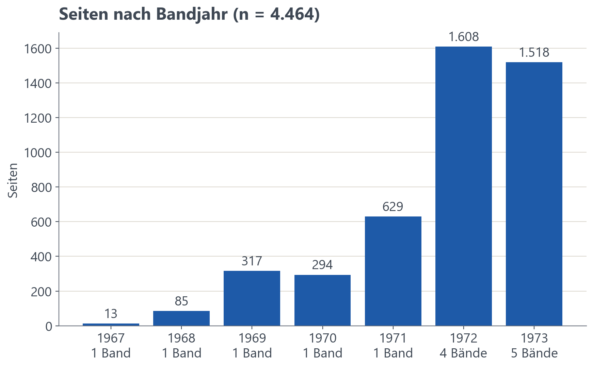

# 2 Der Bestand / Das Korpus

Im Treffen am 20.05.2026 wurde uns von Herrn Becker zudem noch das Universitätsarchiv gezeigt. Hier konnten wir den aktuellen Stand der Flugblattsammlung begutachten. Der Bestand, der die Grundlage für das Korpus des Projekts ist, umfasst 4464 Seiten aus 14 Bänden der Jahre 1967–1973. Jedoch war das nicht von Anfang an klar und sollte später erst festgelegt werden.

## 2.1 Korpuswahl

Zu Beginn war das eigentliche Ziel, den Korpus aus einer anderen Flugblattsammlung zu schaffen, nämlich der Sammlung Reisner. Diese Sammlung wurde zur selben Zeit wie die Allgemeine Flugblattsammlung durch den damaligen Präsidenten Reisner (TODO: Wer war der Typ?) angefertigt. Jedoch ist diese Sammlung nicht digitalisiert, was viele Stunden oder Tage an Aufwand gewesen wäre. Zudem besteht die Sammlung Reisner nur aus Flugblättern politisch links orientierter Hochschulgruppen, wodurch diese Sammlung keine repräsentative Dokumentation der politischen Geschehnisse zur damaligen Zeit ist, da rechte (Gegen-)Stimmen gänzlich fehlen. Daher wurde in der ersten Besprechung mit Andreas Becker am ? (TODO: Datum) festgelegt, dass statt der Sammlung Reisner die Allgemeine Flugblattsammlung als Korpus dienen sollte, da diese schon teilweise digitalisiert worden ist. Deshalb ist die Allgemeine Flugblattsammlung die Grundlage für das Korpus.

## 2.2 Das Korpus und dessen Gliederung

Das Korpus umfasst die Jahrgänge 1967 bis 1973 der Allgemeinen Flugblattsammlung der Universität Regensburg (Universitätsarchiv, Rep. 118). Die Sammlung wurde 1968 von der Universitätsbibliothek angelegt und 2004 an das Universitätsarchiv übergeben. Verzeichnet wurde sie 2007, 2008 und 2011. 2008 kamen 23 Ordner Flugschriften der Jahre 1967–1995 vom Studentenwerk hinzu und wurden einsortiert [@uar-rep118]. Die Sammlung wächst kaum noch: Gruppen nutzen soziale Medien, und das freie Aushängen ist inzwischen geregelt [@uar-rep118]. Die Jahre um 1970 sind damit Teil eines Bestands, der sich seinem Ende nähert. 

Das Korpus ist in mehrere Untergruppen geteilt. Erstens sind sie in die 6 Jahrgänge geteilt (im physischen Archiv ein Karton). Die Jahrgänge mit mehreren hundert Flugblättern unterteilen sich noch in mehrere Untergruppen/Bände. Es gibt jeweils eine PDF-Datei pro Band. Somit bestehen die 6 Jahrgänge  aus insgesamt 14 PDF-Dateien/Bände. Diese 14 PDF-Dateien/Bände beinhalten jeweils mehrere hundert Flugblätter. Es sind zusammen **4464 Seiten** und rund **1,06 Millionen Token** Volltext. 

Da manche Flugblätter oft mehrseitig sind, wurden im weiteren Verlauf des Projekts daraus **1547 Flugblätter** (Stand 17.10.2026, Exemplare zusammengefasst). Den größten Teil machen politische Flugblätter aus, daneben Einladungen, Broschüren, offene Briefe und Zeitschriften. Herausgeber sind der AStA, die politischen Hochschulgruppen (u. a. RCDS, MSB Spartakus, SHB, Demokratische Front), Fachschaften, Studentenverbindungen und die Hochschulleitung, insgesamt rund 170. Thematisch dominieren Hochschulpolitik und das Bayerische Hochschulgesetz, Hochschulwahlen und Streiks; hinzu kommen bundespolitische und internationale Themen. Es lassen sich keine genauen Zahlen zu den Herausgebern und Themen nennen, da diese Statistiken erst im Laufe des Projekts entstanden sind und viel Ungenauigkeit beinhalten. 

Zahlenmäßig ist der Bestand ungleich verteilt: 70 % der Seiten stammen aus 1972 und 1973, für 1967 liegen nur 13 Seiten mit 6 Flugblättern vor (Band 001). Das spiegelt auch die Geschichte der Universität: Sie nahm den Vorlesungsbetrieb erst am 6. November 1967 auf, und die Proteste gegen das neue Hochschulgesetz prägten vor allem die Jahre 1971 bis 1973 [@becker2021]. Für 1973 fehlt eine von sechs Verzeichnungseinheiten (Einheit 15), die laut Findmittel unter anderem die Blätter zu Berufsverboten und zum Putsch in Chile enthält. Aussagen zu 1973 sind daher Untergrenzen mit inhaltlicher Schlagseite. Mehrfachexemplare desselben Blatts sind nach der Sammlungspraxis gewollt und werden im Korpus nur einmal gezählt.

Die Flugblätter sind meist schreibmaschinengeschrieben, da sie von den Gruppen selbst vervielfältigt wurden. Beispielsweise tragen rund 230 Blätter die Aufschrift „Eigendruck im Selbstverlag“. Zudem sind es auch einzelne Blätter aus Druckereien.

TODO: Tabelle Seiten, Exemplare und Flugblätter je Bandjahr aus `kennzahlen.md`.

## 2.3 Sammlung und Digitalisierung

Zu Beginn der Flugblattsammlung wurden die Flugblätter von Mitarbeitenden der Universität gesammelt und aufbewahrt, dafür gelocht und in Ordnern abgeheftet. Ab 1969 erhielten viele Flugblätter einen Stempel mit dem Datum des Eingangs, wie sich später noch zeigen wird ein wichtiger Anhaltspunkt für den Zeitraum, in dem es veröffentlicht wurde. Bis 2006 wurden die Blätter gelocht und in Ordnern abgeheftet, bis 2007 meist wie beschrieben auf der Vorderseite gestempelt [@uar-rep118]. Die Löcher sind auf den Scans sichtbar, am linken Rand der Vorderseite oder am rechten Rand der Rückseite. Die Eingangsstempel („eingelaufen“) werden in Flugblättern ab dem Jahrgang 1969 bei der Auswertung erkannt: in Band 003 bei 8 von 212 Exemplaren, in den Bänden ab 1970 bei 13 bis 32 % (nach den Korrekturen von Hand, Kap. 5).

Digitalisiert wurden die Flugblätter mithilfe eines Kamera-Aufbau, diese einfache Digitalisierungsmethode war nötig, da die Flugblätter zu verschieden in der Form und Format sind. Zudem sind sie über die Jahre zu schlecht erhalten und zu brüchig für konventionelle Flachbettscanner. Die 14 Bände der 6 Jahrgänge wurden als PDF zusammengefasst, pro Band eine PDF, nach der Digitalisierung zusammen rund 9,2 GB and Dateien. Die Dateien heißen `0118_0001.pdf` bis `0118_0014.pdf` (Rep. 118, Einheit), die Anwendung zeigt sie beispielsweise als „Nr. 001 (1967)“. Jede Seite ist ein farbiges JPEG-Bild ohne Textebene. Die Auflösung, bezogen auf die in den PDFs angegebene Seitengröße von etwa A4, ist nicht einheitlich: Band 001 und 002 haben 300 dpi (1787 × 2479 Pixel), die Bände 003 bis 012 überwiegend 600 dpi (4912 × rund 6970 Pixel) mit einzelnen Seiten in 300 dpi, die Bände 013 und 014 rund 400 dpi (etwa 3400 × 4800 Pixel). Die PDFs wurden mit unterschiedlichen Programmen erzeugt (cChipPDF, PDF24, img2pdf). Ein Band wurde in Form einzelner TIFF-Dateien vom Archiv geliefert, diese Dateien wurden zwecks Homogenität auch zu einer PDF-Datei zusammengefasst. 

## 2.4 Findmittel

Das Universitätsarchiv verzeichnet in der Archivsoftware ACTApro. Der Bestand wurde im Austauschformat HIDA-DOC1-XML exportiert (Schema aus HiDA von startext). Inhalt davon sind Herausgeberlisten, Einzeltitel und Zuordnung von Band und Einheit und ist damit Grundlage für das Herausgeber-Register (Kap. 5).

## 2.5 Überlieferungslücken

Es gibt zudem noch einige Probleme des Korpus, auf die hingewiesen werden muss. Der Band 15 (1973) ist noch nicht digitalisiert. Laut Findmittel enthält sie unter anderem die Blätter zu Berufsverboten und zum Putsch in Chile. Aussagen zu 1973 sind daher Untergrenzen mit inhaltlicher Schlagseite und sollten vor der Ergänzung der restlichen Bände von 1973 für einen allgemeinen repräsentativen Forschungskontext genutzt werden. Zudem ist Band 015 in der Anwendung ein Testimport mit Seiten aus Band 14 (Kap. 5.6) und keine Scans der Einheit 15.

1967 und 1968 sind dünn belegt (13 und 85 Seiten) da die Universität zu diesem Zeitpunkt gerade erst eröffnet worden ist. (Kap. 1.1). 

Mehrfachexemplare sind nach der Sammlungspraxis gewollt: Doppelexemplare wurden behalten, etwa um in Ausstellungen auch die Rückseite zeigen zu können [@uar-rep118]. Im Bestand liegen daher meist zwei oder drei Exemplare, vereinzelt vier, fünf oder mehr (Kap. 6).