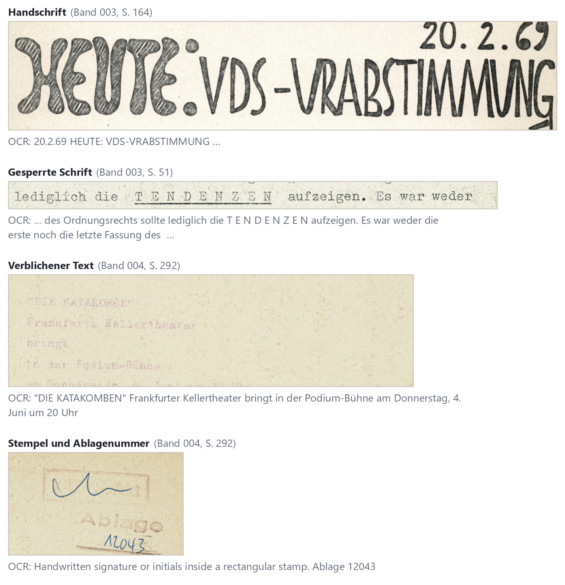
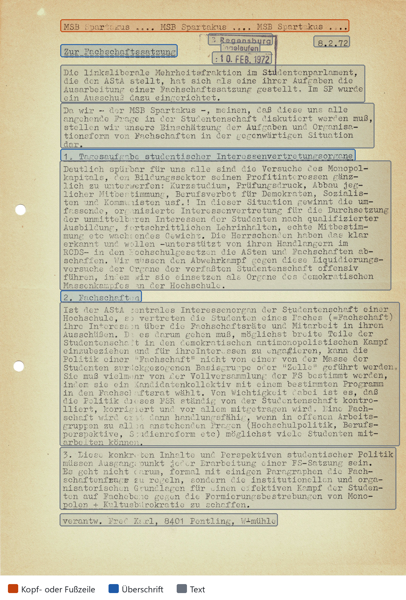

# 3 Text erkennen

Der erste Arbeitsschritt macht aus den Bildern der PDFs Text. Dafür haben wir acht Systeme verglichen und die Datalab API gewählt, weil sie Text und Layout am genauesten wiedergibt. Gemessen an einem von Hand korrigierten Goldstandard sind etwa 6 von 1000 Zeichen falsch. Die Erkennung kostet rund 10 $ je 1000 Seiten und läuft ohne Handarbeit.

Alle weiteren Schritte bauen auf diesem Ergebnis auf. Trennung, Metadaten, Suche und Analyse arbeiten mit dem erkannten Text, und Fehler an dieser Stelle wirken sich auf jeden späteren Schritt aus.

## 3.1 Anforderungen

Das Material macht die Texterkennung schwer. Die meisten Blätter sind mit der Schreibmaschine geschrieben und von den Gruppen selbst vervielfältigt (Kap. 2.2). Das Layout ist oft kompliziert: Neben einspaltigem Fließtext gibt es mehrspaltige Seiten, teils im Querformat, Tabellen, Abbildungen und Stempel. Handschrift steht im Text und am Rand, etwa als Ablagenummer, Unterstreichung oder Korrektur, und manche Stellen sind durchgestrichen. Typisch für die Zeit sind außerdem Sperrschrift zur Hervorhebung, Silbentrennung am Zeilenende, mit der Schreibmaschine überschriebene Stellen und verblichene Abzüge.

Hinzu kommen die Scans selbst. Sie sind Aufnahmen gealterter Blätter mit einem einfachen Kamera-Aufbau, keine digital erzeugten Dateien: Das Papier ist teils verfärbt, die Schrift ausgeblichen, und die Rückseite scheint mitunter durch. Auch die Sprache stellt Anforderungen. Die Texte sind größtenteils deutsch, mit Umlauten und ß, alten Schreibweisen („daß“ neben „dass“) und Umgangs- und Jugendsprache, die heute nicht mehr gebräuchlich ist („Teach-In“).

*Abbildung: Typische Schwierigkeiten und was die Datalab API daraus macht. Die gemalte Überschrift wird zu „VRABSTIMMUNG“ statt „Urabstimmung“; gesperrte Wörter erscheinen Buchstabe für Buchstabe; der stark verblichene Text wird hier richtig gelesen; die Paraphe im Stempel beschreibt die API auf Englisch, die handschriftliche Ablagenummer liest sie richtig.*

Reiner Text genügt für die weiteren Schritte nicht. Die Trennung nutzt Kopfzeilen als Hinweis auf den Beginn eines neuen Flugblatts (Kap. 4), die Textvorverarbeitung filtert Kopf- und Fußzeilen, Seitenzahlen und Bilder heraus (Kap. 7). Das System sollte den Text deshalb in Blöcke gliedern, jedem Block einen Typ zuweisen und seine Lage auf der Seite angeben (Bounding Boxes).

*Abbildung: So gliedert die Datalab API eine Seite (Flugblatt 850, Band 006, S. 394). Jeder Rahmen ist ein Block mit Typ und Lage; Kopfzeile, Überschriften und Fließtext sind getrennt.*

## 3.2 Kandidatensuche

Ein System, das solche Vorlagen bewältigt, muss deutlich mehr leisten als die Erkennung gedruckter Seiten. Gleichzeitig erscheinen im Bereich OCR zurzeit fast monatlich neue, leistungsfähigere Modelle: Allein im ersten Halbjahr 2026 kamen PaddleOCR-VL 1.5 (Januar), GLM-OCR und Chandra OCR 2 (März), MinerU2.5-Pro (April), Gemini 3.5 Flash und PaddleOCR-VL 1.6 (Mai) sowie Mistral OCR 4 und Claude Sonnet 5 (Juni) heraus [@paddleocrvl15; @glmocr; @chandra2; @mineru25pro; @mistralocr4; @claudesonnet5].

Einen Überblick haben wir uns auf drei Wegen verschafft: über die Technical Reports der Entwickler, über die Ranglisten der Benchmarks olmOCR-Bench [@olmocrbench] und OmniDocBench [@omnidocbench] und über Blog- und Forenbeiträge, vor allem auf Reddit und Hacker News. Die Benchmarks erlauben schon vor einem eigenen Test einen ersten Vergleich der Qualität.

Ausgewählt haben wir Systeme aus drei Gruppen. Die erste bilden große Vision-Sprachmodelle für allgemeine Zwecke, die Seiten als Bild entgegennehmen und Text ausgeben (Claude Sonnet 5, Gemini 3.5 Flash und Qwen3-VL). Die zweite sind kommerzielle Dienste, die auf Dokumente spezialisiert sind (Datalab API und Mistral OCR 4). Die dritte sind spezialisierte Modelle mit offenen Gewichten, die in den Quellen häufig für den Betrieb auf eigener Hardware beschrieben werden (GLM-OCR, PaddleOCR und MinerU).

## 3.3 Testkorpus

Um die Systeme zu vergleichen, haben wir ein Testkorpus von 100 Seiten gebildet, je 20 Seiten aus den Jahrgängen 1969, 1970, 1971, 1972 und 1973. Innerhalb eines Jahrgangs wurden die Seiten zufällig und gleichverteilt aus allen Seiten seiner Bände gezogen (Skript `test_set_generator.py`, 30.06.2026), ohne Schichtung nach Layout, Textsorte oder Scanqualität. Die Jahrgänge 1967 (13 Seiten) und 1968 (85 Seiten) haben wir wegen ihres geringen Umfangs nicht aufgenommen.

Gleich viele Seiten je Jahrgang bedeuten eine unterschiedliche Abdeckung. Aus 1969 stammen 20 von 317 Seiten (6,3 %), aus 1973 20 von 1518 (1,3 %); die frühen, kleineren Jahrgänge sind also gegenüber ihrem Anteil am Bestand übergewichtet. Für den Vergleich der Systeme ist das unproblematisch, weil jeder Jahrgang mit genug Seiten vertreten ist. Eine Fehlerrate für den Gesamtbestand müsste dagegen nach Seitenzahl je Jahrgang gewichtet werden.

Die Ziehung verwendete keinen festen Zufallswert und protokollierte die gezogenen Seiten nicht. Ihre Herkunft haben wir deshalb nachträglich über Text- und Bildvergleich rekonstruiert: 98 der 100 Seiten ließen sich eindeutig einem Band zuordnen, nur zwei leere Seiten nicht.

## 3.4 Kandidaten und Merkmale

<!-- TODO: Betrieb von PaddleOCR und MinerU ergänzen, je Merkmal mit Quelle, Version und Abrufdatum.
     Modellkennungen laut Ausgabedateien: anthropic/claude-sonnet-5, qwen/qwen3-vl-235b-a22b-instruct
     (beide über OpenRouter), gemini-3.5-flash; Läufe am 09.07.2026.
     GLM-OCR: Der Test lief am 08.07.2026 mit GLM-OCR/ocr_test.py, das nur Text je Seite liefert. Das spätere
     glm_convert.py (Ausgabe jsonGLM vom 17.08.2026) erzeugt über PP-DocLayout-V3 Blöcke mit Lage; falls das
     erwähnt werden soll, als Nachtrag kennzeichnen. -->

Am 08.07. und 09.07.2026 haben wir alle acht Systeme auf das Testkorpus angewendet. Die Skripte dafür liegen im Arbeits-Repository (Kap. 12.6). Die Tabelle fasst zusammen, wie sie gebaut sind und was sie liefern.

| System | Entwickler | Größe | Release | Art | Betrieb im Test | Blöcke mit Lage | Anmerkung |
|---|---|---|---|---|---|---|---|
| GLM-OCR | Zhipu AI / Z.ai / Tsinghua | 0,9 B (CogViT 0,4 B + GLM 0,5 B), spezialisiertes VLM | 11.03.2026 | spezialisiertes OCR-Modell, offene Gewichte | selbst gehostet, Modell direkt angesprochen | nein, nur Text | läuft über Ollama auch ohne GPU |
| PaddleOCR-VL-1.6 | Baidu / PaddlePaddle | 0,9 B, architektonisch identisch zu 1.5 | 28.05.2026 | OCR-Pipeline aus Erkennung und Lesung von Zeilen, offene Gewichte | lokal ausgeführt | Zeilen mit Lage, keine Blocktypen | Layout im Test oft falsch erkannt |
| MinerU2.5-Pro | OpenDataLab / Shanghai AI Lab | 1,2 B (NaViT 0,675 B + Qwen2-Instruct 0,5 B) | 2604-Version: Apr. 2026 · 2605-Update: 21.05.2026 | Dokument-Pipeline aus Layout- und OCR-Modellen, offene Gewichte | lokal ausgeführt | ja | geringere Textgenauigkeit |
| Qwen3-VL (235B-A22B-Instruct) | Alibaba / Qwen Team | 235 B MoE (22 B aktiv), General-Purpose-VLM | 23.09.2025 (Report: Nov. 2025) | allgemeines Vision-Sprachmodell | API über OpenRouter | nein, nur Text | gute Textgenauigkeit |
| Claude Sonnet 5 | Anthropic | proprietär, General-Purpose-LLM mit Vision | 30.06.2026 | allgemeines Vision-Sprachmodell | API über OpenRouter, Seiten als Bilder gesendet | nein, nur Text |  |
| Gemini 3.5 Flash | Google | proprietär, General-Purpose-LLM mit Vision | 19.06.2026 | allgemeines Vision-Sprachmodell | Gemini-API | nein, nur Text |  |
| Datalab API (verbesserte Fassung von Chandra OCR 2) | Datalab | proprietäre Pipeline um Chandra 2 herum — nicht identisch mit den offenen Gewichten | laufend | OCR-Dienst | API | ja, mit Blocktypen | Wort-Boxen optional |
| Mistral OCR 4 | Mistral AI | proprietär, kompaktes API-Modell (self-hosting per Container möglich) | 23.06.2026 (OCR 4.1 Public Preview: 16.07.2026) | OCR-Dienst | API | ja | Confidence-Wert je Wort |

Die Entwickler veröffentlichen eigene Benchmark-Ergebnisse, aber nicht für alle Kandidaten und nicht immer für die getesteten Fassungen [@glmocr; @paddleocrvl15; @mineru25pro; @qwen3vl; @claudesonnet5; @chandra2; @mistralocr4]. Eine Übersicht mit Größe, Lizenz, Benchmark-Werten und allen Quellen liegt im Arbeits-Repository unter `pipelines/03_eval/ocr-modelle-uebersicht.md` (Stand 17.08.2026). Vergleichen lassen sich diese Zahlen nur eingeschränkt. Die Versionen 1.0, 1.5 und 1.6 von OmniDocBench [@omnidocbench] verwenden unterschiedliche Bewertungsverfahren, ihre Werte lassen sich nicht nebeneinanderstellen. olmOCR-Bench [@olmocrbench] hat eine Unsicherheit von etwa einem Punkt, Abstände unter rund zwei Punkten sagen daher wenig. An seiner Methodik gibt es außerdem Kritik [@llamaindexolmocr]: Die Testfälle wurden aus Seiten erzeugt, die Claude Sonnet 4.0 geschrieben hat, und die Kategorie für Kopf- und Fußzeilen belohnt das Weglassen sichtbarer Inhalte. Bei Datalab sind die gehostete API und die offenen Gewichte von Chandra OCR 2 verschiedene Systeme mit verschiedenen Ergebnissen; wir haben die API genutzt.

## 3.5 Vorauswahl

Eine erste Durchsicht der Ausgaben schloss sechs Systeme aus. GLM-OCR, Claude Sonnet 5 und Gemini 3.5 Flash lieferten nur Text, ohne Bounding Boxes und ohne Blocktypen. Ihnen fehlt damit eine Layouterkennung, die Tabellen, Listen und mehrspaltige Seiten als solche wiedergibt. Qwen3-VL erkannte den Text gut, gliederte die Seite aber ebenfalls nicht. PaddleOCR erkannte das Layout häufig falsch, MinerU erkannte es, lieferte aber eine geringere Textgenauigkeit. Die besten Ergebnisse erzielten die Datalab API, die eine verbesserte Fassung von Chandra OCR 2 einsetzt, und Mistral OCR 4. Diese beiden kamen in die engere Wahl.

Auf dem Testkorpus verhielten sich beide in vielem gleich. Sie erkennen auch komplexe Layouts, gliedern die Seite in Blöcke mit Lage und Typ, kommen mit Handschrift gut zurecht und beschreiben Abbildungen. Über die API kostet Mistral OCR 4 4 $ je 1000 Seiten, die Datalab API im Modus `accurate` 10 $ (Preise Stand August 2026, siehe 3.9). Beide Anbieter veröffentlichen eigene Benchmark-Ergebnisse für Deutsch (Datalab) bzw. für die westeuropäische Sprachgruppe (Mistral). Im olmOCR-Bench geben sie 86,7 ± 0,8 Punkte für die Datalab API [@chandra2] und 85,20 Punkte für Mistral OCR 4 an [@mistralocr4]. Das sind Herstellerangaben, die wir nicht selbst nachgemessen haben, und der Abstand liegt innerhalb der Unsicherheit des Benchmarks. Mistral OCR 4 liefert zusätzlich für jedes Wort einen Confidence-Wert und war in unserem Test schneller: Die 100 Testseiten waren in 14 bis 22 Sekunden verarbeitet. Weil die Zahlen beide Systeme kaum trennen, haben wir ihre Ausgaben direkt verglichen.

## 3.6 Qualitativer Vergleich

Dazu haben wir beide Ausgaben Seite für Seite nebeneinandergelegt. Jede der drei Personen im Team übernahm ein Drittel des Testkorpus (Seiten 1 bis 33, 34 bis 66 und 67 bis 100) und notierte Unterschiede und wiederkehrende Muster.

Bei der Wortgenauigkeit lag Datalab meist vorn, besonders bei verblichenem Text, wo ein Wortvergleich deutlich weniger Fehler zeigte (Seiten 5 und 24). Mistral ersetzte mehrfach seltene Wörter durch geläufige, etwa „Aluminium“ statt „Alumneum“ und „ständigen“ statt „stämmigen“, verlas getippte Zahlen und schrieb einen Professorennamen falsch, den Datalab richtig erkannte. Seite 49 hat Mistral nicht verarbeitet, Seite 50 vollständig halluziniert. Erfundene Wörter kamen aber bei beiden Systemen vor: Aus „Gesicht und Nacken“ wurde bei Datalab „Gesicht und Rücken“, bei Mistral „Gesicht und Backen“. Datalab schrieb „AStA“ auf einer Seite als „ASTA“, auf einer anderen richtig; Mistral las das große S in „AStA“ einmal als „ß“. Ein Verdacht, Datalab habe auf Seite 86 Text in einer Schleife wiederholt, bestätigte sich in der gespeicherten Ausgabe nicht.

Auch das Layout gab Datalab näher am Original wieder. Mistral fasste mehrfach Blöcke zusammen, die getrennt stehen (auf Seite 3 etwa 17 statt 19 Blöcke), und verschmolz einmal zwei Listenpunkte. Tabellen erkannte Datalab als Tabellen, Mistral nur als einzelne Zeilen (Seiten 9 und 16). Datalab unterscheidet Kopf- und Fußzeilen, Mistral fasst beide in einer Kategorie zusammen und hielt auf Seite 5 drei Elemente fälschlich für Kopfzeilen. Auf Seite 31 erkannte dagegen nur Mistral die Fußzeile richtig.

Von der Formatierung übernahm Datalab mehr: Unterstreichungen, Nummern in Aufzählungen, Zeilenumbrüche in Impressumsangaben, doppelte Anführungszeichen und handschriftliche Hervorhebungen als Fettdruck. Mistral wandelte doppelte in einfache Anführungszeichen um, erkannte dafür Hochstellungen und behielt das „ß“, das Datalab teils durch „ss“ ersetzte. Wo mit der Schreibmaschine nachträglich korrigiert wurde, gab Datalab eher den ursprünglichen Text wieder, Mistral eher die Korrektur.

An Handschrift scheiterten beide an denselben Stellen: „Urabstimmung“ wurde zu „Vrabstimmung“, handschriftliche Ablagenummern und verschnörkelte Schrift las keines der Systeme richtig. Nachträgliche Korrekturen von Hand verarbeiteten beide gut. Gesperrte Wörter („T E N D E N Z E N“) gaben beide meist Buchstabe für Buchstabe wieder. Unsere Beobachtungen dazu sind nicht einheitlich; auf einer Seite fügte Mistral die Buchstaben zu Wörtern zusammen, was für die Suche brauchbarer ist. Bei der Silbentrennung am Zeilenende waren die Ergebnisse wechselhaft: Mal setzte Mistral die Wortteile richtig zusammen (Seite 15), mal Datalab (Seite 30). Datalab neigte allgemein dazu, Wörter zusammenzuziehen, Mistral dazu, sie unnötig zu trennen.

Zu Abbildungen erzeugte Datalab zutreffende Beschreibungen in englischer Sprache, Mistral auf denselben Seiten nicht. Datalab schnitt Bilder großzügiger aus und verwies einmal auf die falsche Bilddatei, beschrieb aber das richtige Bild. Buchstaben, die zu einem Bild angeordnet sind, erkannte keines der Systeme.

Nach diesem Vergleich haben wir uns im Team vorläufig für Datalab entschieden. Wie genau Datalab ist, sollte der Goldstandard zeigen.

## 3.7 Goldstandard

Für den Goldstandard haben wir die Datalab-Ausgabe des Testkorpus im Korrekturmodus des OCR-Viewers, eines eigenen Werkzeugs für den Vergleich der Systeme, Block für Block gegen den Scan geprüft und berichtigt. Eine Seite galt als fertig, wenn jeder Block als geprüft oder unleserlich markiert und Layout und Lesereihenfolge bewertet waren. Die Fehlerraten haben wir mit dinglehopper berechnet. Die Seiten 1 bis 5 bearbeiteten alle drei Personen, um die Übereinstimmung zwischen ihnen zu prüfen. Bis zum 03.08.2026 entstanden 113 Seitenannotationen, davon 105 vollständige, die in die Auswertung eingingen. Die Kürzel in der Tabelle stehen für Felix Lindner (fl), Sebastian Simbeck (ss) und Veit Korpies (vk).

| Person | Seiten | CER (Mittel je Seite) | WER (Mittel je Seite) | CER (längengewichtet) | WER (längengewichtet) |
|---|---|---|---|---|---|
| fl | 33 | 0,85 % | 5,32 % | 0,56 % | 3,39 % |
| ss | 37 | 0,99 % | 3,51 % | 0,62 % | 3,03 % |
| vk | 35 | 0,83 % | 1,54 % | 0,60 % | 1,33 % |
| gesamt | 105 | 0,89 % | 3,42 % | 0,60 % | 2,53 % |

Über alle 105 bewerteten Seiten liegt die Zeichenfehlerrate (Character Error Rate, CER) bei 0,60 %, die Wortfehlerrate (Word Error Rate, WER) bei 2,53 % (jeweils längengewichtet). Die Werte der drei Personen unterscheiden sich, weil jede andere Flugblätter bearbeitet hat. Auf den fünf Kalibrierungsseiten, die alle drei bearbeitet haben, lag die Zeichenfehlerrate bei allen unter 1 % und je Seite höchstens 0,3 Prozentpunkte auseinander.

Fehler im Layout wiesen 18 der 105 Seiten auf (17 %), Fehler in der Lesereihenfolge 8 (8 %). Typisch waren Blöcke in falscher Reihenfolge, Blöcke, die zusammengehören, aber getrennt erkannt wurden, ein spiegelverkehrt gescanntes Blatt, ein als Bild erkannter Stempel und gesperrt geschriebene Buchstaben, die die Erkennung stören. Als unleserlich markiert wurden insgesamt 20 Blöcke. Die übrigen Markierungen für fehlende, überzählige, zusammengefasste oder geteilte Blöcke wurden nicht vergeben.

## 3.8 Entscheidung

Vergleich und Goldstandard bestätigten die Datalab API als geeignetes System für diesen Bestand. Den Ausschlag gaben die höhere Textgenauigkeit, vor allem bei verblichenen Seiten und Eigennamen, und die genauere Wiedergabe des Layouts. Für die weitere Verarbeitung zählt außerdem, dass Datalab Kopf- und Fußzeilen getrennt ausweist und Tabellen als solche erkennt. Die Vorteile von Mistral OCR 4, die Confidence-Werte je Wort und die höhere Geschwindigkeit, wogen das nicht auf.

## 3.9 Produktionslauf

Mit dieser Entscheidung haben wir den Gesamtbestand von 14 Bänden mit 4464 Seiten zwischen dem 17.08. und 19.08.2026 mit der Datalab API im Modus `accurate` verarbeitet, mit Kopf- und Fußzeilen und den Abbildungen in der Ausgabe.

Weil Datalab Dateien nur bis 200 MB annimmt, schickt das Skript jeden Band in Abschnitten von höchstens 50 Seiten und fügt die Ergebnisse am Ende zu einer Datei je Band zusammen. Bricht ein Lauf ab, setzt ein erneuter Aufruf bei den fehlenden Abschnitten fort, ohne bereits bezahlte erneut zu verarbeiten. Ein Band mit gut 300 Seiten war nach wenigen Minuten fertig.

Datalab berechnet im Modus `accurate` 10 $ je 1000 Seiten. Für die 4464 Seiten ergeben sich damit rund 45 $, von denen ein Teil durch das monatliche Gratisguthaben gedeckt war ([Kennzahlen](../kennzahlen.md#kosten)). Für neue Bände zeigt die Anwendung vor der Texterkennung eine Kostenschätzung an (Kap. 9). Sie rechnet mit demselben Listenpreis und stimmt gut mit den abgerechneten Beträgen überein.

## 3.10 Grenzen der Evaluation

Die Messung hat vier Grenzen. Das Testkorpus ist mit 100 Seiten klein und übergewichtet die frühen Jahrgänge (3.3); Seiten aus 1967 und 1968 fehlen ganz.

Der Goldstandard entstand durch Nachkorrektur der Datalab-Ausgabe. Wer eine vorhandene Ausgabe korrigiert, übersieht leichter Fehler als jemand, der unabhängig abschreibt. Die gemessene Fehlerrate von Datalab ist daher eher eine Untergrenze. Mistral OCR 4 haben wir nicht an diesem Goldstandard gemessen; der Vergleich der beiden Systeme in 3.6 ist qualitativ.

Für diesen Vergleich gab es kein gemeinsames Bewertungsschema, was sich bei der Auswertung bemerkbar machte. Die Beobachtungen lassen sich daher nicht auszählen und widersprechen sich in Einzelfällen, etwa bei der Sperrschrift. Die Benchmark-Werte in 3.4 sind Angaben der Anbieter und wurden nicht überprüft.

Schließlich lassen sich die Läufe nur eingeschränkt wiederholen, weil sich die Modelle hinter den Diensten ändern. Gemini 3.5 Flash ist inzwischen abgekündigt. Anfragen unter dieser Modellkennung werden auf Gemini 3.6 Flash umgeleitet und liefern heute also ein anderes Modell.
