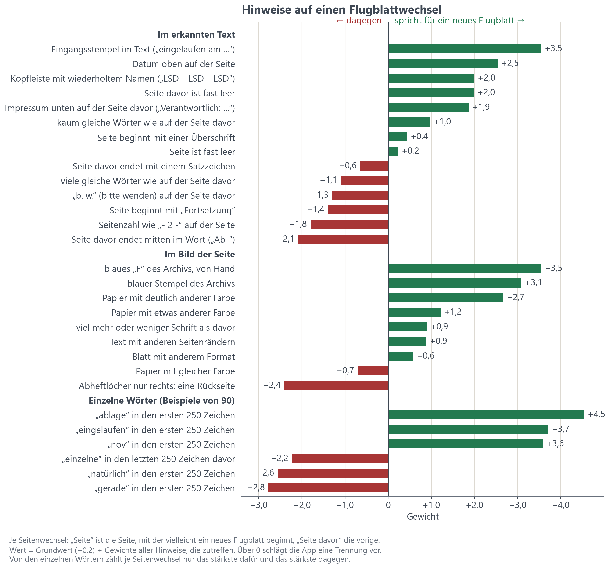
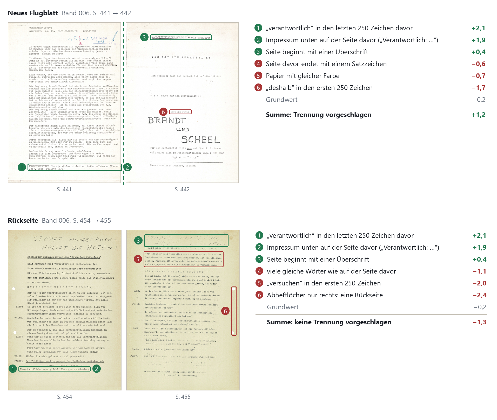

# 4 Flugblätter trennen

Ein Band unseres Gesamtbestandes umfasst eine Menge an Einzelseiten, deren Zugehörigkeit zu einem bestimmten Flugblatt nicht direkt vermerkt ist. Da Flugblätter sowohl aus einer einzelnen als auch aus mehreren Seiten bestehen können, ist es wichtig, die Übergänge zwischen zwei Blättern klar zu kennzeichnen. Durch gezielte Trennungen werden die Seiten eines jeden Bandes in einzelne Flugblätter unterteilt, woraus eine Gesamtzahl von 1927 Exemplaren für den gesamten Bestand resultiert. Dieser Prozess ist auch beim Importieren neuer Bände innerhalb der Anwendung notwendig. Hier sollen Vorschläge für Trennungen dem Nutzer helfen und diesen Arbeitsschritt beschleunigen. Etwa fünf von sechs dieser Vorschläge können korrekt übernommen werden. Somit kann der Prozess beschleunigt werden, eine manuelle Trennung ist jedoch immer noch notwendig.

## 4.1 Aufgabe

In diesem Schritt wird festgelegt, welche Bandseiten gemeinsam ein einzelnes (aber mehrseitiges) Flugblatt bilden. Die Texterkennung erfolgt bereits vor der Seitentrennung, da wichtige Hinweise auf den Beginn eines neuen Flugblatts, wie Kopfzeilen, Papierfarbe, Abheftlöcher, Stempel oder auch Datumsangaben aus dem Text gewonnen werden. Diese Merkmale bilden zudem eine wichtige Grundlage für die automatisiert generierten Vorschläge für Trennungen während des Imports.

## 4.2 Herausforderungen

Start- und Endseite einzelner Flugblätter sind nicht immer eindeutig erkennbar. Grenzfälle, wie Hefte und Anlagen, Rückseiten ohne eigenen Kopf sowie Trennblätter sind Beispiele für entstehende Herausforderungen beim Abgrenzen der Exemplare. Insbesondere in den Bänden des Jahrgangs 1973 sind zudem nur wenige aussagekräftige Kopfzeilen und Stempel vorhanden, die zur Identifikation von Trennstellen herangezogen werden können. Daher müssen für uneindeutige Fälle einheitliche Regeln festgelegt werden, um eine Trennung des Bestandes so neutral und konsistent wie möglich zu gestalten.

Folgende Regeln ergaben sich während der manuellen Abgrenzung der Flugblattseiten am 29.09.2026:

- Zusammengehörige Hefte und Dokumentationen bleiben ein Flugblatt, auch wenn einzelne Beiträge eigene Kopfzeilen aufweisen. Ein Beispiel hierfür ist das *Fachbereichsinfo Nr. 10* in Band 005 mit den Heftseiten 1 bis 25 (S. 444–470).
- Eine Rückseite wird einem offensichtlich zugehörigen Flugblatt zugeordnet, auch wenn sie nach einem „b. w.“ ("bitte wenden") eine eigene Kopfzeile aufweist.
- Trägt eine Rückseite einen eigenständigen Text mit eigenem anderen Herausgeber als die Vorderseite, wird sie ein als separates Flugblatt gekennzeichnet. So befinden sich beispielsweise in Band 013 AStA-Informationen auf der Rückseite einer Bekanntmachung des Ältestenrats vom 22.06.1973.
- Mehrfachexemplare werden zunächst als separate Exemplare behandelt und erst im nächsten Schritt zusammengeführt (siehe Kap. 6).
- Seiten, die innerhalb eines Flugblattes eine falsche Reihenfolge aufweisen, werden in diesem Schritt nicht direkt umsortiert. Stattdessen wird der Fehler im jeweiligen Segment vermerkt.

Für angehängte Resolutionen und Pressespiegel wurden bislang keine eindeutigen Regeln festgelegt.

## 4.3 Altes Verfahren

Die 14 Bände wurden mithilfe des Werkzeugs `flugblatt_splitter` manuell abgegrenzt. Dieses Werkzeug war nicht dasselbe wie das aktuell in der Anwendung integrierte Trenn-Tool des Import Verfahrens, letzteres wurde erst später zur Anwendung hinzugefügt. Die Arbeit wurde auf drei Personen verteilt und im August abgeschlossen. Für Band 002 wurde die manuelle Trennung mit einer automatischen Segmentierung durch Datalab verglichen. Während bei der händischen Trennung 59 Segmente entstanden, erkannte Datalab lediglich 13 einzelne Flugblätter. Dabei wurden alle 13 automatischen Segmentierungen auch manuell vorgenommen. Es wurden demnach keine Schnitte durch Datalab gesetzt, die zuvor nicht auch händisch festgelegt wurden. 46 der 59 manuellen Segmentierungen wurden jedoch von Datalab übersehen. Da keine der beiden Trennungen zu diesem Zeitpunkt qualitativ überprüft worden war, konnte aus diesem Schritt lediglich abgeleitet werden, inwiefern sich die Entscheidungen unterschieden. Dennoch wurde eine Vollautomatisierung aufgrund dieser Beobachtungen vorerst für weitere Segmentierungen ausgeschlossen.

Später wurde die Import-Funktion zur Anwendung hinzugefügt, und damit auch die Überarbeitete Version des Flugblatt-Trenners. Für den Import neuer Bände werden gestützt auf dem erkannten Text (`src/backend/app/boundaries.py`) Vorschläge zur Segmentierung bereitgestellt. Jeder Seitenübergang wird hierbei anhand von 14 Merkmalen bewertet und einem naiven Bayes-Klassifikator verrechnet. Die zugrundeliegenden Gewichte wurden mithilfe der manuellen Segmentierung der Bände 1–14 erarbeitet. Demnach wird eine Trennung ab einer Wahrscheinlichkeit von 0,5 vorgeschlagen. Dieses Verfahren läuft lokal und ohne Zuhilfenahme eines Sprachmodells.

Als Hinweise auf den Beginn eines neuen Flugblatts dienen beispielsweise Eingangsstempel, Datumsangaben in der Kopfzeile, eine Kopfleiste mit Gruppenkürzeln und Impressen sowie eine nahezu leere vorausgehende Seite oder auch eine geringe Anzahl gemeinsamer Wörter mit der vorangegangenen Seite. Gegen eine neue Trennstelle sprechen beispielsweise Seitenzahlen wie „- 2 -“, Trennstriche oder ein „b. w.“ am Ende der vorherigen Seite. Auch wörtliche Hinweise, wie „Fortsetzung“ am Seitenanfang sowie eine große Anzahl gemeinsamer Wörter zwischen zwei aufeinanderfolgenden Seiten deuten auf ein fortlaufendes Flugblatt hin.

Für die Bände 13 und 14 wurde zusätzlich eine Locherkennung eingeführt. Sind die Abheftlöcher nur auf der rechten Seite erkennbar, wird die Seite als Rückseite eingeordnet und demnach kein Beginn eines neuen Flugblattes vermutet. 

Um den Sektionierungsvorgang zu beschleunigen, wird zusätzlich die Möglichkeit geboten, eine vorannotierte Liste während des Imports zu übergeben, welche sämtliche dokumentierte Trennstellen beinhaltet. Dadurch kann die Sektionierung sofort automatisch durchgeführt werden und eine nachträgliche manuelle Trennung kann umgangen werden. 

*TODO: Beispielbild einer Liste oder Feature hinzufügen*

## 4.4 Neues Verfahren

Kurz vor Beendigung des Projekts wurde dann nochmal die Splitter-Funktion der Import-Funktion der Anwendung überarbeitet. Jetzt kommen zu den 14 Merkmalen im Text noch eine Wortliste mit konkreten Wörtern, die das Flugblattende signalisieren können und neun visuelle Aspekte, die aus dem Scan extrahiert werden. Jetzt funktioniert die Erkennung der Abheftlöcher auf allen Flugblättern aller Bände und jeden neuen Import. Sowohl schwarze als auch weisse Löcher können erkannt werden.

Der Naive-Bayes-Klassifikator selbst ist geblieben: Jeder Hinweis hat ein Gewicht, positiv für ein neues Flugblatt und negativ dagegen; neu sind die zusätzlichen Hinweise aus Wortliste und Scan, wodurch sowohl ein Flugblattende erkannt werden kann, als auch ein nicht bevorstehendes Ende bestätigt werden kann. Diese ganzen Gewichte werden aufsummiert, und liegt das Ergebnis über Null, schlägt die App eine Trennung vor. Ohne jeden Hinweis wird nicht getrennt, der Grundwert entspricht dem Anteil der Seitenwechsel mit Trennung in den Bänden 1–14 (1986 von 4 450, 44,6 %). Erstellt wurden die Gewichte an der Handtrennung der Bände 1–14.

Für die Wortliste wurden die letzten 250 Zeichen der Seite davor und die ersten 250 Zeichen jeder Seite verglichen, bei Seitenwechseln mit und ohne Trennung. Übrig blieben etwa 90 Wörter. Herausgenommen wurden Namen, Orte und Wörter einzelner Gruppen, dazugenommen alle Monate und Wochentage. Je Seitenwechsel zählt nur das stärkste Wort dafür und das stärkste dagegen. 

Beispiele dafür: „Eigendruck“ am Ende der Seite davor, „eingelaufen“ oder „Ablage“ am Seitenanfang. 

Beispiele dagegen: „natürlich“, „jedoch“, „deshalb“. Das sind Wörter, die mitten im Gedankengang stehen.

Nach dem Hochladen wird jede Seite einmal klein dargestellt und ausgewertet, im Hintergrund und parallel zur Texterkennung. Mit der Seite davor verglichen werden Papierfarbe, Format, Ränder und Tintenmenge. Sind die Abheftlöcher nur rechts zu sehen, ist die Seite eine Rückseite. Das blaue „F“ und die blauen Stempel des Archivs erkennt die Auswertung an der Farbe: Blaue Tinte schluckt mehr Rot als Blau, graue Schreibmaschinenschrift alle Farben gleich. Graue oder blasse Stempel bleiben im Bild deshalb unsichtbar; meist findet sie aber die Texterkennung. Leerseiten mit fast keinen dunklen Kanten bekommen kein Gewicht. Der Vorschlag lässt sie direkt als „Leerseite / Trennblatt“ aus, sie gehören zu keinem Flugblatt. Die Gewichte aller Hinweise stehen in der folgenden Abbildung.

*Abbildung: Hinweise auf einen Flugblattwechsel und ihre Gewichte. Grün spricht für ein neues Flugblatt, rot dagegen. Die Summe mit dem Grundwert ergibt den Wert, der in der Anwendung zwischen den Knöpfen steht.*

*Abbildung: Zwei knappe Seitenwechsel aus Band 006 mit den Hinweisen, die die Anwendung dort findet. Oben beginnt mit S. 442 ein neues Flugblatt („Was ist ein Strauzel???“), obwohl das Papier gleich ist und „deshalb“ unter den ersten 250 Zeichen des erkannten Texts steht. Den Ausschlag gibt das Impressum unten auf S. 441, die Summe ist +1,2. Unten endet S. 454 ebenfalls mit einem Impressum, doch S. 455 hat die Abheftlöcher rechts und ist damit eine Rückseite. Mit −1,3 schlägt die Anwendung richtig keine Trennung vor.*

## 4.5 Qualität des neuen Verfahrens

| Vorschlag | Fehler je 100 Seitenwechsel | Präzision | Trefferquote |
|---|---|---|---|
| nur Text (bisher) | 20,3 | 0,78 | 0,76 |
| Text + Wortliste + Scan (jetzt) | **12,7** | **0,83** | **0,91** |

Ohne Vorschlag müsste man 1986 Trennungen selbst setzen. Mit Vorschlag sind noch **565 Stellen** zu ändern (377 zu viel, 188 fehlen), also **72 % weniger** verglichen mit dem alten System.

- Präzision 0,83: Etwa jeder sechste vorgeschlagene Schnitt ist falsch.
- Trefferquote 0,91: Etwa jeder elfte echte Anfang fehlt.

Die Auswahl der Merkmale und Wörter wurde mit Blick auf alle 14 Bände getroffen, nur die Gewichte sind sauber getrennt gelernt. Die Zahlen sind deshalb leicht optimistisch. Leerseiten sind in den Zahlen nicht enthalten. Wie gut das System auf neue Bände anwendbar ist, wurde nicht getestet und muss nach Erhalt neuer Bände getestet werden.

## 4.6 Manuelle Prüfung

TODO: Grundlegende Beschreibung Trennsystem

(TODO: A genaue Beschreibung sollte eher im Tutorial sein und ned in der Doku)

## 4.7 Ergebnis und Kosten

Die 4464 Seiten des Gesamtbestandes wurden in 1927 eigenständige Flugblattexemplare unterteilt. Hinzu kommen 115 Seiten, die keinem Flugblatt zugeordnet werden konnten. Hierbei handelt es sich in der Regel um Trennblätter oder leere Rückseiten. Fünf dieser Seiten wiesen dennoch potenziell relevanten Text auf und sollten daher nochmals überprüft werden.

Die Auswertung der Scans für die automatischen Trennvorschläge braucht etwa 40 ms je Seite, im Docker-Container unter Windows etwa 0,5 s, weil das Lesen vom Windows-Laufwerk langsam ist. Der Vorschlag selbst kommt danach sofort.

Aufgrund der vollständig lokalen Verarbeitung entstehen für diesen Arbeitsschritt keine zusätzlichen Kosten für externe Dienste oder cloudbasierte Sprachmodelle innerhalb der Anwendung.

*Abbildung: Ergebnis der Trennung in der Bandansicht (Band 006, S. 392–397). Jede Spalte ist ein Flugblatt; Flugblatt 850 („Zur Fachschaftssatzung“, S. 394) ist markiert. Leere Rückseiten sind ausgeschlossen, S. 392 und 396–397 sind weitere Exemplare; ihr Hauptexemplar liegt in Band 008 bzw. weiter vorn in Band 006.*

## 4.8 Hinweise zur Weiterentwicklung (TODO: Do soll da Felix moi schauen)

Die Implementierung der Trennvorschläge befindet sich in src/backend/app/boundaries.py und src/backend/app/segments.py. Die Herkunft der verwendeten Merkmale und Gewichte ist im Arbeits-Repository unter pipelines/01_pdf/ auffindbar. 

Bei einer wesentlichen Erweiterung des Bestandes sollte vor dem Import geprüft werden, ob eine wiederholte Anpassung der Gewichte erforderlich sein könnte. Als besondere Herausforderung für eine Weiterentwicklung erweist sich die zuverlässige Erkennung von Rückseiten. Diese weisen oftmals keinerlei eindeutigen Merkmale auf, die auf das Ende bzw. einen Anfang eines Flugblattes hindeuten.
