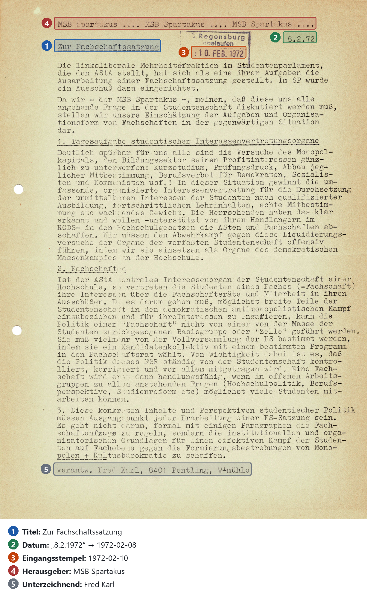

# 5 Metadaten erzeugen

Um eine spätere Durchsuchbarkeit der einzelnen Flugblatt-Exemplare zu ermöglichen, werden diese um strukturierte Metadaten ergänzt. Die Metadatenextraktion erfolgt dabei am erkannten Text mithilfe eines Sprachmodells und umfasst Informationen wie Titel, Datum, Herausgeber und weitere Angaben. Um nachvollziehbare Ergebnisse zu gewährleisten, wird das Modell angewiesen, Textstellen als "Belege" für die meisten der erhobenen Metadaten zu hinterlegen. Die Genauigkeit der extrahierten Daten wurde bislang noch nicht evaluiert.

## 5.1 Aufgabe und Felder

Für jedes Exemplar werden die in der folgenden Tabelle aufgeführten Metadaten ermittelt. Diese werden mit Ausnahme der Textsorte und der Selbsteinschätzung durch mindestens eine wörtliche Belegstelle im Text sowie der Nummern der zugehörigen OCR-Blöcke validiert (siehe Kapitel 5.3). Dieser Schritt ist insbesondere bei der Verwendung eines KI-Sprachmodells notwendig um fehlerhafte Interpretationen sowie Halluzinationen nachvollziehen zu können.

| Feld | Inhalt | Beispiel: Flugblatt 850 |
|---|---|---|
| Titel | Überschrift oder Textanfang (sofern keine Überschrift erkennbar) | „Zur Fachschaftssatzung“ |
| Reihe und Heft | Name einer Reihe oder Zeitschrift mit Nummer | – |
| Herausgeber | auf dem Blatt angegebener Name, gegebenenfalls mit Funktion oder Vermerk; Zuordnung zum (Herausgeber-)Register | „MSB Spartakus“ |
| Unterzeichnende | auf dem Blatt angegebener Name, gegebenenfalls mit Funktion oder Vermerk wie „V.i.S.d.P.“ | „Fred Karl“, Vermerk „verantw.“ |
| Datum | Datum in Wortlaut, normalisiertes Datum und Art der Angabe (Erscheinen, Veranstaltung, undatiert) | „8.2.72“, 1972-02-08, Erscheinen |
| Eingangsstempel | Datum des Archivstempels, getrennt vom Datum auf dem Blatt | „10. FEB. 1972“, 1972-02-10 |
| Textsorte | Flugblatt im engeren Sinn, Einladung, Broschüre, Zeitschrift, offener Brief, Protokoll oder unklar | Flugblatt |
| Selbsteinschätzung | Vom Modell selbst angegebener Wert zwischen 0 und 1, der seine Sicherheit bei der Extraktion einschätzt | 0,85 |

Die Auswahl der zu erhebenden Metadaten orientiert sich an vergleichbaren Sammlungen. So führt bspw. die Frankfurter Sammlung Informationen wie Datum, Urheber, Thema und Art des Dokuments für ihre Flugblätter auf [@frankfurt-flugblaetter]. Die ergänzende Nennung von Belegstellen bei diesem Projekt dient der Transparenz. Zudem werden Herausgeber und Unterzeichnende getrennt erfasst, um herausgebende Organisation von der verantwortlichen beziehungsweise unterzeichnenden Person unterscheiden zu können.

## 5.2 Herausforderungen

Ab 1969 weisen einige Flugblätter einen Eingangsstempel des Archivs auf deren Vorderseite auf. Dieses Artefakt kann bei vielen Exemplaren der Sammlung bis zum Jahr 2007 gefunden werden [@uar-rep118]. Bei diesen Fällen kann es zu mehreren unterschiedlichen Datumsangaben auf einem einzigen Blatt kommen, bspw. "08.02.1972" als Erscheinungsdatum und "10.02.1972" als Eingangsdatum. Somit ist eine korrekte Unterscheidung dieser beiden Angaben bei der Metadatenextraktion wichtig und stellt zugleich eine Herausforderung für das verwendete Sprachmodell dar.

Eine weitere Herausforderung ist die korrekte Erfassung der Herausgeber. Die Namen dieser erscheinen oft als Kürzel in der jeweiligen Kopfleiste und weisen teils unterschiedliche Schreibweisen auf. Um eine zuverlässige und einheitliche Identifizierung zu gewährleisten, müssen die erkannten Angaben einer in einem zentralen Herausgeberregister gespeicherten Organisation zugeordnet werden. 

## 5.3 Verfahren

Am 22.09.2026 wurden zunächst vier Modelle an Band 002 getestet: *Gemini 2.5 Flash*, *GPT-5 mini*, *Qwen3235B* und *Claude Sonnet 4.5*. Für die anschließende Erschließung der Bände 1–14 wurde hiernach *Claude Sonnet 4.5* (`anthropic/claude-sonnet-4.5`) ausgewählt. Dieses wurde über OpenRouter mit Prompt v2 aufgerufen, wobei je 20 Flugblätter pro Anfrage bearbeitet wurden. Die Ergebnisse der Bände 001–004 stammen aus Läufen vom 30.09.2026 (Kennungen `claude-r9`, `claude-r11`, `claude-r11a2`). Die Nummern 005–014 resultierten aus einem Lauf vom 02.10.2026 (`claude-r12`). Zwischen diesen Läufen wurde der Prompt weiter überarbeitet. Die einzelnen Fassungen sind im Arbeits-Repository (Kap. 12.6) dokumentiert.

Das Modell gibt die Ergebnisse nach einem festgelegten Schema im JSON-Format aus. Der zugrundeliegende Prompt kann in `src/backend/app/metadata_prompt.txt` eingesehen werden. Für jedes Feld gilt eine Belegpflicht: Für jedes Feld werden zunächst die wörtliche Textstelle und die OCR-Blöcke angegeben, erst hiernach wird der zugehörige Wert extrahiert. Die Pipeline prüft anschließend, ob die genannte Stelle tatsächlich im OCR-Text steht. Um keine nicht durch den Text gestützten Informationen zu verarbeiten, muss diese Prüfung positiv ausfallen, um den Wert in ein Metadatum zu überführen. 

Der Zuordnung der Herausgeber liegt ein Register zugrunde. Dieses wurde zuvor aus dem Findmittel aufgebaut. Jede Organisation ist darin unter einem kanonischen Namen aufgeführt und um ein Kürzel sowie bekannte alternative Schreibweisen ergänzt. Da nur sehr wenige der in den Flugblättern auftretenden Gruppen in der Gemeinsamen Normdatei (GND) eingetragen sind, findet ein Abgleich mit dieser nicht statt. Die Information über den Jahrgang wird grundsätzlich aus dem auf dem Flugblatt angegebenen Datum abgeleitet. Fehlt diese Information, wird das Jahr des zugehörigen Bandes als Metadatum verwendet.

*Abbildung: Belegstellen der Metadaten für Flugblatt 850 (Band 006, S. 394). Das Modell trennt das Datum auf dem Blatt (8.2.72) vom Eingangsstempel des Archivs (10. Feb. 1972) und nennt für jeden Wert den Block, aus dem er stammt.*

## 5.4 Qualität

Die Belegprüfung der Pipeline wurde für 2000 Segmente durchgeführt. Bei 1731 Segmenten (86,5 %) wurden keine Beanstandungen festgestellt. Die Implementierung erfolgte in `check_grounding` in `extract_metadata_v2.py`. Die genauen Ergebnisse können unter `grounding` in `data/nr0XX_metadata.json` eingesehen werden. Zu beachten ist, dass hierbei nicht die Richtigkeit der Erhebungen geprüft werden, sondern lediglich, ob die extrahierten Informationen durch Belege gestützt werden.

Um Auswirkungen der jeweiligen Prompt-Fassungen zu vergleichen, wurden die Bände 002–004 am 17.10.2026 erneut mit dem für die Bände 005–014 verwendeten Prompt verarbeitet (`claude-r12`). Verglichen mit den früheren Fassungen lag bei den insgesamt 464 Flugblättern 25 mal (5 %) ein anderes Datum vor, die Textsorte änderte sich in 24 (5 %) Exemplaren, 58 mal (13 %, teils nur andere Schreibweisen) unterschieden sich die Herausgeber und 115 mal (25 %, meist Länge und Zeichensetzung) die Titel. 

Die Ergebnisse der Belegprüfung wiesen bei den erneuten Läufen leichte Unterschiede auf. Die Werte lagen bei 86,2 %, 90,6 % und 89,2 %, während für die ersten Läufe 84,5 %, 87,7 % und 85,1 % erreicht wurden. Da sich die extrahierten Angaben zwischen den Läufen teilweise änderten, behält die Anwendung die Ergebnisse der ursprünglichen Läufe bei. Die wiederholten Läufe sind im Arbeits-Repository dokumentiert (Kap. 12.6). Als Grund für die entstandenen Unterschiede wurden sowohl die Änderung des Prompts als auch ein gewisser Zufallsfaktor vermutet.

Um die Reproduzierbarkeit der Ergebnisse bei unverändertem Prompt zu testen, müssen dieselben Bände erneut mit denselben Einstellungen wie im Lauf `claude-r12` verarbeitet und die Resultate beider Läufe miteinander verglichen werden.

Außerdem haben wir die Titel mit denen verglichen, die das Findmittel für 1968 und 1969 nennt. Als Referenz für die Genauigkeit taugen sie aber nicht: Das Archiv kürzt und vereinheitlicht seine Titel, nennt nur eine Auswahl der Blätter („u. a.“), und schon die Zuordnung eines Archivtitels zu einem unserer Flugblätter ist unsicher. Eine Messung gegen eine verlässliche Referenz fehlt deshalb (Kap. 10.1).

Für den Bestand lassen sich folgende Zahlen festhalten: 169 Herausgeber werden auf mindestens einem Flugblatt genannt. Bei 24 Flugblättern tritt ein Herausgeber auf, welcher nicht Teil des Herausgeberregisters ist. Wie oft die einzelnen Metadatenfelder befüllt sind und welche Auswirkungen Korrekturen auf die Informationen hatten, zeigt die Auswertung in Kapitel 5.5

## 5.5 Manuelle Prüfung

Manuelle Korrekturen können in der Leseansicht über „Beleg wählen“ vorgenommen und in `data/corrections.jsonl` gespeichert werden. Felder, die dort geändert wurden, gelten als von Hand korrigiert.

Bis zum 12.10.2026 wurden 142 der 1547 Flugblätter in mindestens einem Feld korrigiert. Die folgende Tabelle zeigt für jedes Feld, bei wie vielen Flugblättern nach der Extraktion bereits ein Wert vorlag, wie viele Exemplare nach der manuellen Korrektur Informationen aufweisen und bei wie vielen Blättern das jeweilige Feld korrigiert wurde. Berücksichtigt werden ausschließlich die Hauptexemplare (Datenbank vom 17.10.2026).

| Feld | automatisch | nach Korrektur | korrigiert |
|---|---|---|---|
| Titel | 1520 (98 %) | 1520 (98 %) | 10 |
| Reihe und Heft | 404 (26 %) | 415 (27 %) | 13 |
| Datum auf dem Blatt | 722 (47 %) | 705 (46 %) | 38 |
| Eingangsstempel | 255 (16 %) | 353 (23 %) | 105 |
| Herausgeber | 1300 (84 %) | 1306 (84 %) | 13 |
| Unterzeichnende | 695 (45 %) | 697 (45 %) | 8 |
| Textsorte (nicht „unklar“) | 1513 (98 %) | 1513 (98 %) | 1 |

Die meisten Korrekturen betreffen den Eingangsstempel. In 98 Fällen konnte das Modell keinen Stempel erkennen, obwohl ein solcher vorhanden gewesen wäre. In 24 Fällen wurde ein zuvor extrahiertes Datum entfernt, 22 mal hiervon wurde es zugleich als Eingangsstempel eingetragen. Das Modell hatte den Stempel somit als Erscheinungsdatum erkannt. Die Korrekturen entstanden größtenteils bei der Prüfung der Mehrfachexemplare vom 05. bis 11.10. (Kap. 6.5): Von den 146 Exemplaren, die bis zum 12.10. korrigiert wurden, gehören 131 zu einer Gruppe von Mehrfachexemplaren. Die Auswahl ist also keine Stichprobe, und die Zahlen erlauben keinen Schluss auf die Genauigkeit der übrigen Flugblätter.

Neue Herausgeber werden während des Imports im Schritt „Prüfen & freigeben“ dem Herausgeberregister zugeordnet. Nach dieser Zuordnung ist auch eine automatische Erkennung bei der Verarbeitung späterer Bände möglich.

## 5.6 Kosten

Für den Testimport am 20.10.2026 hatten wir die ersten 230 Seiten von Band 15 (Kap. 2.5). Mit *Claude Sonnet 4.5*, dem Modell der Bände 1–14, kostet die Metadatenextraktion danach etwa 9 \$ je 1000 Seiten (2,11 \$ für die 230 Seiten), mit *Claude Opus 5.5* etwa 10 \$ (hochgerechnet aus einem Testlauf mit 56 Flugblättern aus Band 014: 1,36 \$).

Hinweise für die Weiterentwicklung stehen im Handbuch [Weiterentwickeln](../handbuch/weiterentwickeln.md#metadaten).
