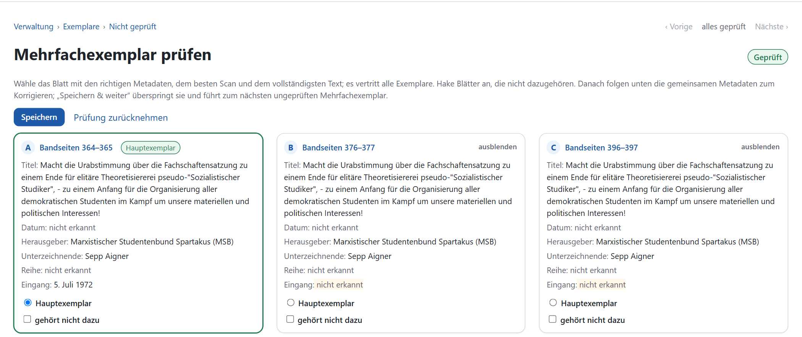
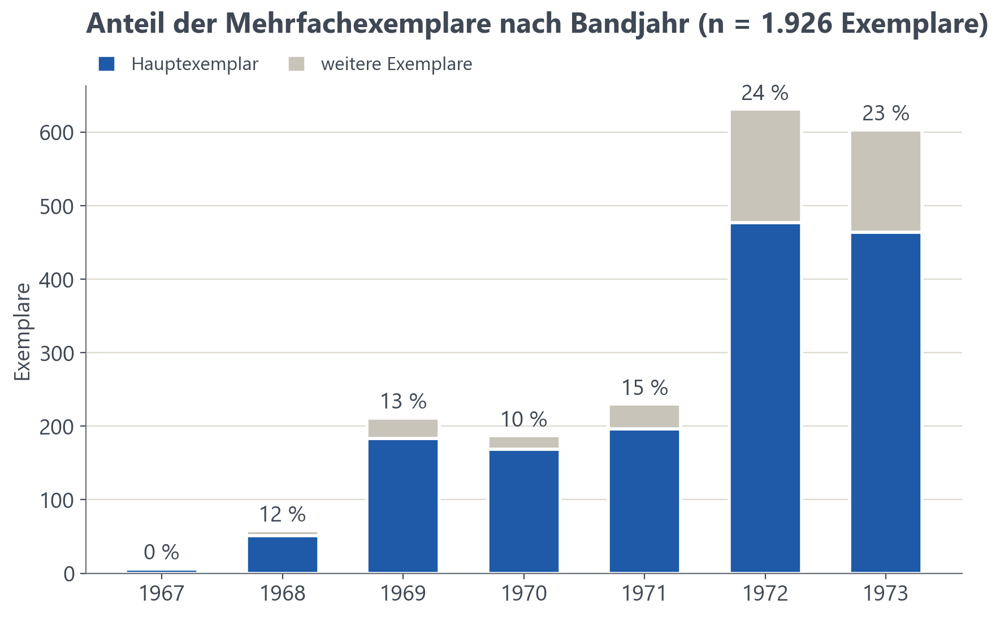
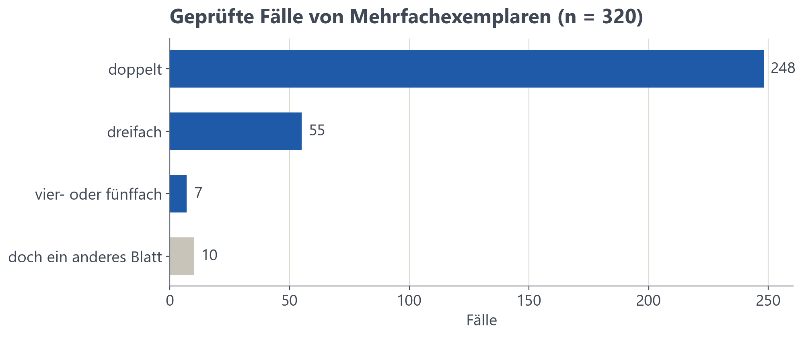

# 6 Mehrfachexemplare zusammenführen

Etwa ein Fünftel der 1927 Exemplare sind weitere identische Versionen eines bereits im Bestand vorhandenen Flugblatts. Potenzielle Mehrfachexemplare werden zunächst in der Anwendung anhand von Textähnlichkeit gekennzeichnet. Mithilfe eines integrierten Tools kann die Zuordnung anschließend manuell überprüft und bestätigt werden. Bei diesem Schritt wird ein sogenanntes Hauptexemplar bestimmt. Alle Exemplare bleiben auch nach der Kontrolle als eigenständige Datensätze vorhanden.

## 6.1 Aufgabe

Ziel ist es, Mehrfachexemplare eines einzigen Flugblatts zu identifizieren, um bei späteren Auswertungen bzw. Datenanalysen jeden Inhalt nur einfach zu behandeln. Das Auftreten dieser Mehrfachexemplare ist Teil der Sammlungspraxis: Nach Möglichkeit bewahrt das Archiv bewusst mehrere Versionen des gleichen Flugblatts auf, um beispielsweise bei Ausstellungen auch die Rückseite präsentieren zu können [@uar-rep118] (Kap. 2.5). Es handelt sich dabei also nicht um einen Digitalisierungsfehler, welcher behoben werden muss, sondern um eine Eigenschaft des Bestandes, die bei einer Auswertung Berücksichtigung erfordert.

## 6.2 Herausforderungen

Selbst bei identischen Inhalten unterscheiden sich die erkannten Texte mehrerer Exemplare oft geringfügig, da bei jedem Scan unterschiedliche OCR-Fehler auftreten können. Für eine zuverlässige Erkennung von Mehrfachexemplaren ist ein ausschließlicher direkter Textvergleich somit nicht ausreichend. Zusätzlich konnte beobachtet werden, dass identische Exemplare sowohl innerhalb desselben Bandes als auch über mehrere Bände hinweg vorkommen können. So liegt das "Theoriepapier Nr. 4 " des RCDS bspw. viermal in Band 7 vor. Über zwei Bände verteilt sind 59 der 310 Gruppen: „Zulassungs-Stop im Fach Psychologie“ vom 8. Januar 1969 etwa liegt zweimal in Band 002 (1968) und ein weiteres Mal in Band 003 (1969). Gleichzeitig müssen Nachdrucke, die den Inhalt verändern, als eigene Fassungen erkennbar bleiben, um inhaltliche Untersuchungen aufgrund ihrer Unterschiede anstellen zu können.

## 6.3 Verfahren

Die Suche nach Mehrfachexemplaren wurde über alle Bände des Bestands hinweg durchgeführt. Kandidaten ergeben sich aus der Ähnlichkeit der bge-m3-Embeddings ab einem Kosinuswert von 0,85. Bestätigt werden sie über Zeichen-5-Gramme auf normalisiertem Text. Die Schwellen sind an der Verteilung über alle Bände kalibriert: Ab einem Jaccard-Wert von 0,75 gilt ein Paar als Exemplar, zwischen 0,5 und 0,75 als mögliche Fassung, die von Hand geprüft wird. Darunter teilen zwei Blätter meist nur Bausteine wie Formulare oder Wahllisten.

Enthält ein deutlich längerer Text nahezu vollständig den Text eines kürzeren Flugblatts, wird dies als „enthalten“ markiert. Ein derartiger Fall kann auf einen nicht erkannten Schnitt zwischen zwei Flugblättern hinweisen. Bei Texten mit weniger als 150 Zeichen ist kein Vergleich möglich.

Beim Import neuer Bände werden keine Embeddings verwendet. In diesem Fall grenzt die Anwendung zunächst mögliche Kandidaten anhand seltener Wörter ein. Anschließend wird die Textähnlichkeit mit derselben 5-Gramm-Methode wie zuvor und den beschriebenen Schwellenwerten bewertet.

Mehrfachexemplare werden als solche markiert, jedoch nicht direkt zusammengeführt. Jedes Exemplar bleibt ein eigenständiger Datensatz mit eigener Stelle im Karton, individuellen Stempeln und Vermerken. Auch die Metadaten werden für jedes Exemplar einzeln erzeugt. In Listen, bei Auswertungen und Exporten vertritt das Hauptexemplar die Gruppe der Mehrfachexemplare. Informationen der übrigen Versionen bleiben erhalten.

## 6.4 Qualität

Von den 320 vermuteten Mehrfachexemplar-Gruppen konnten tatsächlich 310 als solche bestätigt werden. Somit liegt der Anteil an False Positives für unseren Bestand bei 3,13%. Der von der Anwendung bereitgestellte Vorschlag für das Hauptexemplar, welcher auf der Textlänge der einzelnen Exemplare basiert, wurde bei 62% der Gruppen übernommen.

## 6.5 Manuelle Prüfung

Die manuelle Prüfung findet in der Ansicht `/exemplare` statt. Hier werden die Exemplare einer Gruppe nebeneinander angezeigt. Abweichungen bei Datum, Titel und Herausgeber werden in einer eigenen Metadaten-Tabelle hervorgehoben. Fehlerhaft erkannte Mehrfachexemplare werden verworfen, während bei einer korrekten Annahme ein Hauptexemplar ausgewählt werden muss. Hiernach können die Metadaten der repräsentativen Version überprüft und bearbeitet werden. Dabei werden auch wesentliche Informationen der anderen Exemplare der Gruppe angezeigt und können samt Beleg (falls vorhanden) übernommen werden. 

*Abbildung: Prüfung einer Gruppe in der Anwendung. Drei Exemplare desselben Flugblatts aus Band 006 (S. 364–365, 376–377 und 396–397) stehen nebeneinander; markiert ist die abweichende Angabe zum Eingangsstempel, den nur das gewählte Hauptexemplar trägt.*

Insgesamt wurden 320 Fälle geprüft. Bei 310 dieser Gruppen konnten tatsächlich Mehrfachexemplare festgestellt werden: Darunter sind 248 Duplikate, 55 Gruppen mit jeweils drei Exemplaren und sieben Gruppen mit vier oder fünf Versionen. Bei den übrigen 10 Fällen handelt es sich um unterschiedliche Flugblätter, deren Inhalt fälschlicherweise als identisch erkannt wurde. Jede Prüfung dauerte von der Auswahl des Hauptexemplares bis zum Abgleichen der Metadaten ca. 1 - 2 Minuten. 

Die Entscheidungen werden in `data/copy_decisions.jsonl` dokumentiert. Hierbei wird die Datei fortlaufend ergänzt, bestehende Einträge werden nicht überschrieben. Einzelne Blätter werden anhand ihres Bandes und Seitenbereichs identifiziert. Die Gruppennummern spielen hierbei keine Rolle. Somit können Entscheidungen auch bei Änderungen an der Gruppierung nachvollzogen werden. 

## 6.6 Ergebnis und Kosten

Aus den 1927 Exemplaren ergeben sich insgesamt 1547 eigenständige Flugblätter. Die übrigen 380 Exemplare machen somit rund 19,7% des Bestandes aus. Dabei unterscheidet sich der Anteil an Mehrfachexemplaren zwischen den Jahrgängen: In den Bänden, welche die Jahre 1968 bis 1971 umfassen, liegt dieser zwischen 10 und 15 %. Im Jahrgang 1972 beträgt der Anteil 24% und 1973 23%. 

Sämtliche Angaben von Zahlen innerhalb der Anwendung, die beispielsweise Herausgeber, Themen und Trends, Größe des Korpus, Veröffentlichungen innerhalb eines Jahres und viele weitere wichtige Informationen zum Bestand beschreiben, berücksichtigen jedes eigenständige Flugblatt nur einmal. Bei einer Suche werden weiterhin alle Exemplare einbezogen, bei Treffern wird jedoch immer nur das Hauptexemplar angezeigt. Für die Erkennung und Gruppierung der Mehrfachexemplare fallen keine Kosten für externe API-Aufrufe an.

Hinweise für die Weiterentwicklung stehen im Handbuch [Weiterentwickeln](../handbuch/weiterentwickeln.md#mehrfachexemplare).
