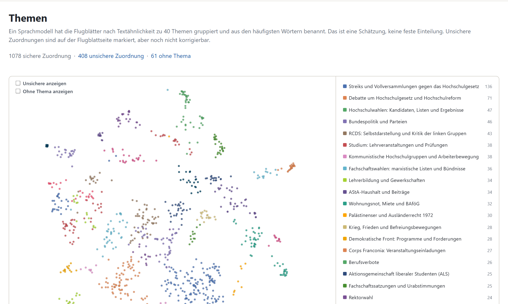

# 7 Themen zuordnen

Nach der Erkennung der Mehrfachexemplare sollen nun der Inhalt der Flugblätter automatisch gruppiert werden, sodass das Durchsuchen des Korpus basieren auf den Themen der Flugblätter möglich ist. Zudem vereinfacht es den Suchprozess im Korpus, da so automatisch ähnliche Flugblätter ermittelt werden können, was einen Zugang zum Korpus ermöglicht, das die Findmittel bisher nicht bereitgestellt haben.

Das Topic-Modelling-System wurde mittels iterativer Verbesserungen erstellt. Zu Beginn wurde in einem eigenen Branch des Arbeits-Repositorys (Kap. 12.6) ein einfaches Setup erstellt und dann kontinuierlich verbessert, bis die Ergebnisse zur Anwendung passend waren. Diese Topic-Modelling-Pipeline wurde dann im Laufe der Entwicklung der Import-Funktion in die Anwendung integriert.

## 7.1 Aufgabe

Ein sogenanntes Topic Modelling System sollte inhaltlich ähnliche Flugblätter in Themen gruppieren. Die Themen sollen einen inhaltlichen Zugang zum Bestand schaffen, neben der Suche nach Wörtern und der Ordnung nach Bänden und Herausgebern.

## 7.2 Herausforderungen

Viele Flugblätter behandeln mehrere Themen, das wurde zum aktuellen Stand noch nicht berücksichtigt. Außerdem überlagern formelhafte Wörter, Gruppenkürzel und Reste der Texterkennung den eigentlichen Inhalt.

## 7.3 Verfahren

Vor der Berechnung wird der Text bereinigt. Aus der Texterkennung bleiben nur die Textblöcke,  Bilder, Kopf- und Fußzeilen fallen weg. Vermerke des Archivs wie „Ablage“ mit Eingangsstempel, „z. K.“ oder „Erbitte Rückgabe“ werden entfernt. Flugblätter mit weniger als 50 Zeichen Text gehen nicht ein, längere Texte werden nach 16000 Zeichen abgeschnitten. Silbentrennungen werden nicht zusammengeführt und Gruppenkürzel nicht vereinheitlicht. Das macht nur das N-Gramm-Werkzeug (`handbuch/ngramme-auswerten.md`). Die Anwendung bereitet den Text beim Zuordnen neuer Bände und bei der Neuberechnung genauso auf.

Das Modell bge-m3 bildet dann den ganzen Text jedes Flugblatts als Vektor ab, bis zu einer Länge von 8192 Token. BERTopic gruppiert diese Vektoren mit UMAP und HDBSCAN zu 50 Themen, die anschließend auf 40 zusammengefasst werden. Für die Schlagwörter eines Themas zählen nur Substantive in ihrer Grundform (spaCy, Modell `de_core_news_lg`). Stoppwörter und Kürzel von Organisationen werden dabei nicht berücksichtigt. 

Manche Flugblätter, die im initialen Topic Modelling Lauf als Outlier klassifiziert wurden und daher kein Thema erhalten hatten, bekommen nachträglich ein Thema zugeordnet, basierend auf der Ähnlichkeit. Diese Zuordnung wurde aber nicht getestet, und dient nur der Vollständigkeit. Diese nachträglichen Zuordnungen wurden auch entsprechend markiert.

## 7.4 Qualität

Die Qualität der Zuordnung wurde nicht gemessen. 1078 Flugblätter sind sicher zugeordnet, 408 unsicher und 61 haben kein Thema. Die größten Themen sind „Streiks und Vollversammlungen gegen das Hochschulgesetz“ (136 Flugblätter), „Debatte um Hochschulgesetz und Hochschulreform“ (71) und „Hochschulwahlen: Kandidaten, Listen und Ergebnisse“ (47).

Fehlzuordnungen kommen vor. Das Flugblatt zum Streik gegen die Notstandsgesetze vom 29.05.1968 etwa liegt im Thema zum Hochschulgesetz, weil es in beiden um Streiks geht.

*Abbildung: Themenkarte der Anwendung. Jeder Punkt ist ein Flugblatt, nahe Punkte haben ähnliche Texte. Flugblatt 850 gehört zum Thema „Fachschaftssatzungen und Urabstimmungen“ (25 Flugblätter).*

## 7.5 Manuelle Prüfung

Von Hand werden die Titel der Themen geprüft und bei Bedarf umbenannt. Das geht in der Anwendung unter Verwaltung › Themen. Die Titel stehen in `data/topics.json`.

## 7.6 Kosten

Ein Lauf über den ganzen Bestand kostet wenige Cent.

Hinweise für die Weiterentwicklung stehen im Handbuch [Weiterentwicklung](../handbuch/weiterentwickeln.md#themen).
