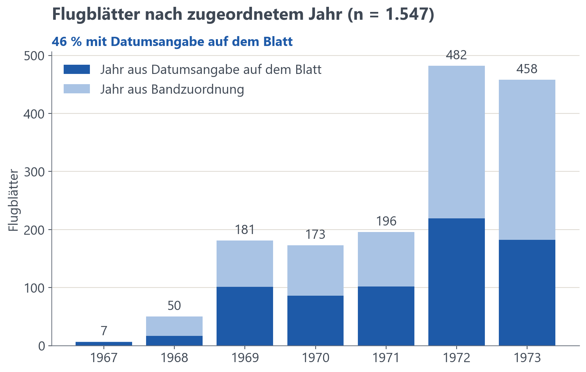
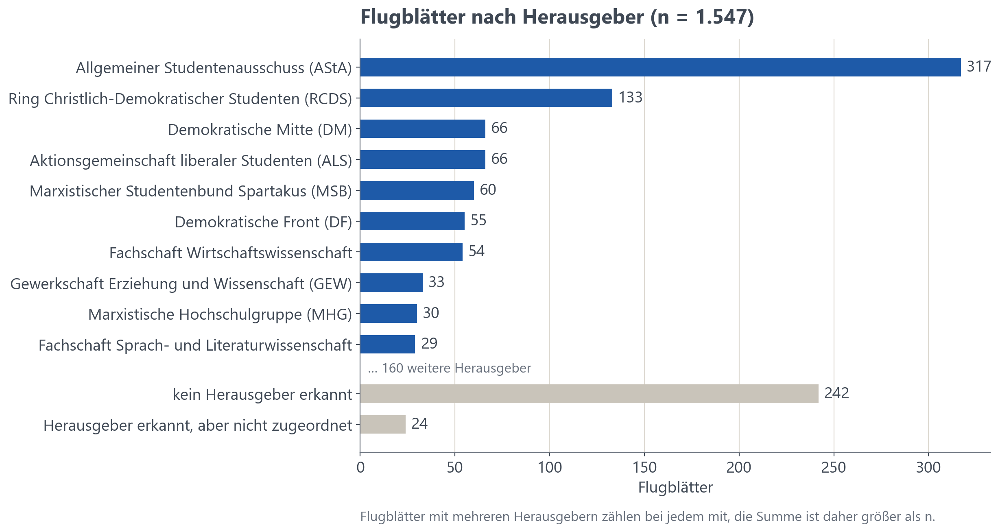
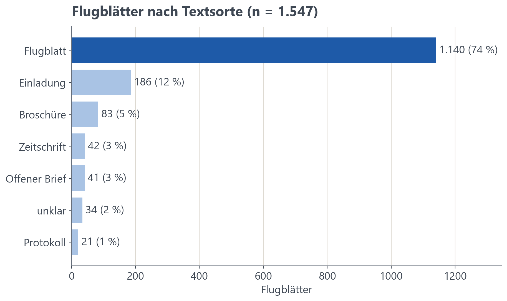
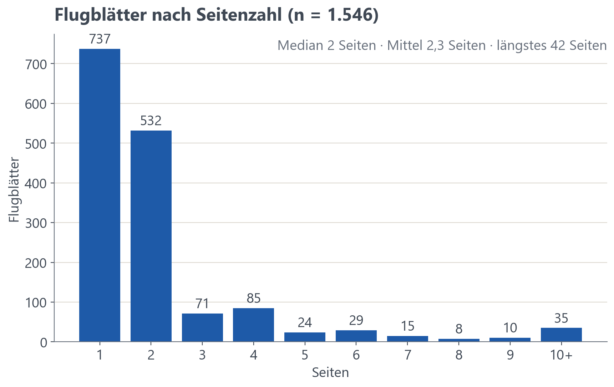

# 8 Das Korpus in Zahlen

Das Korpus umfasst 1 547 Flugblätter in 1 927 Exemplaren auf 4 464 Seiten. Die Zahlen beschreiben den überlieferten und erschlossenen Bestand, nicht die damalige Publikationstätigkeit. Alle Zahlen stammen aus `kennzahlen.md` (Stand 17.10.2026).

## 8.1 Drei Ebenen

- Seite (4 464), Exemplar (1 927), Flugblatt (1 547, vertreten durch sein Hauptexemplar).
- Begriffe: „Flugblatt“ meint wie im Namen der Sammlung jedes Stück, auch Einladungen und Broschüren. „Exemplar“ ist ein physisches Stück; weitere Exemplare heißen im Archiv „Doppelstücke“. Als Textsorte meint „Flugblatt“ enger das einzelne Blatt mit Aufruf oder Stellungnahme.
- Neuschnitt ohne neue Texterkennung möglich, weil Seiten und Flugblätter getrennt gespeichert sind.

## 8.2 Zählregeln

- Jedes Flugblatt zählt einmal, über sein Hauptexemplar.
- Ein Flugblatt mit mehreren Herausgebern zählt bei jedem; die Summe ist dann größer als die Zahl der Flugblätter.
- Flugblätter ohne Datum auf dem Blatt zählen im Jahr ihres Bandes.

## 8.3 Verteilungen

- Jahr: Nach zugeordnetem Jahr (Datum auf dem Blatt, sonst Jahr des Bandes) stellen 1972 und 1973 940 der 1 547 Flugblätter (61 %); nach dem Jahr des Bandes sind es 941 (`kennzahlen.md`). 46 % tragen ein Datum auf dem Blatt.
- Herausgeber: 169 im Register mit mindestens einem Flugblatt. Die größten: AStA (318), RCDS (133), Aktionsgemeinschaft liberaler Studenten (67), Demokratische Mitte (66), MSB Spartakus (60).
- Textsorten: Flugblatt im engeren Sinn 1 139 (74 %), Einladung 187 (12 %), Broschüre 83, Zeitschrift 42, offener Brief 41, Protokoll 21, unklar 34.
- Umfang: Median 2 Seiten, Mittel 2,3, längstes Flugblatt 42 Seiten; 738 Flugblätter haben eine Seite.

<!-- Abbildungen aus scripts/corpus_figures.ipynb (STIL = 'doku'). Nach Änderungen an der Datenbank neu ausführen. -->

## 8.4 Lesart

- Flugblätter sind Mittel der Agitation. Ihren Verfassern ging es oft nicht um „die korrekte Wiedergabe von Fakten“ [@hamburg-flugblaetter]. Zahlen zu Themen und Herausgebern zeigen, wer sich wie oft zu Wort meldete und wie sich die Gruppen selbst darstellten, nicht, was tatsächlich geschah.
- Die Häufung 1972/73 passt zur Geschichte der Universität: Andreas Becker nennt 1971 bis 1973 die „eigentlich revolutionäre Zeit“ der Universität, geprägt von den Protesten gegen das neue Hochschulgesetz [@becker2021]. Zugleich zeigt sie, was überliefert ist; aus der Zahl der Blätter allein lässt sich nicht auf die Stärke der Proteste schließen.
- Für 1973 fehlt Einheit 15 (Kap. 2.5).
