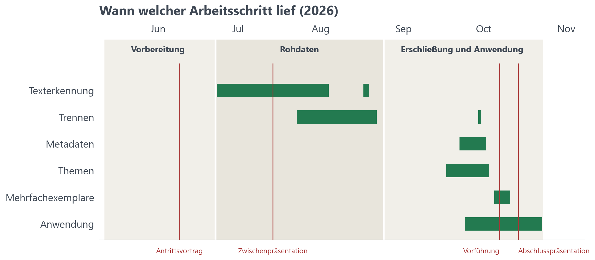

# 12 Projektverlauf und Organisation

<!-- Fassung von Sebastian vom 23.10.2026 (Commit 44af357), ergänzt um Punkte aus Felix' Fassung (Backup außerhalb des Repos). Stichpunkte mit Quellen: arbeitsdokumente/kap12-stichpunkte.md
     und arbeitsdokumente/offene-punkte.md (Abschnitt „Projektmanagement“).
     Noch offen und im Text mit [offen] markiert:
     Tag des Seitenvergleichs und Beginn des Trennens; Aufwand für OCR-Tests, Prompt und Topic Modelling; Anteil von Veit
     und Sebastian an der Anwendung; Beträge aus den Dashboards; ob es zu Beginn eine Aufwandsplanung gab; „Was sich
     bewährt hat“ vom Team bestätigen; Tabelle zum KI-Einsatz füllen und den Einsatz beim Schreiben klären.
     Wo sich Aufwände oder Daten nicht mehr klären lassen: „nicht erfasst“ bzw. „um den …“ statt [offen].
     Vor der Abgabe prüfen: Kapitel 10 nennt die 176 offenen Stellen beim Trennen und den fehlenden Test von Sonnet 5.
     Alle Daten ohne Jahr sind aus 2026. -->

Dieses Kapitel beschreibt, wer im Projekt was gemacht hat, wie der tatsächliche Verlauf vom Plan aus dem Antrittsvortrag abwich und wie wir die Arbeit organisiert haben. Danach folgen Aufwand und Kosten, unsere Erfahrungen und zum Schluss welche KI-Werkzeuge eingesetzt wurden.

## 12.1 Team und Betreuung

Das Projekt entstand im Praxisseminar des Masterstudiengangs Medieninformatik an der Universität Regensburg im Sommersemester 2026. Im Team waren Veit Korpies, Felix Lindner und Sebastian Simbeck. Betreut wurde es in erster Linie von Thomas Schmidt, und Prof. Christian Wolff, Jakob Fehle und Niklas Donhauser waren zusätzliche Ansprechpartner. Zudem war Ansprechpartner im Universitätsarchiv Dr. Andreas Becker.

Feste Rollen wurden nicht vergeben. Aus den Aufgaben ergaben sich aber Schwerpunkte, die über das Projekt hinweg weitgehend stabil blieben:

| Bereich | Wer |
|---|---|
| Testkorpus für die Texterkennung | Veit |
| OCR-Tests mit Datalab, Mistral OCR 4, Claude Sonnet 5, Gemini 3.5 Flash, Qwen3-VL und MinerU | Felix |
| OCR-Tests mit GLM-OCR | Sebastian |
| OCR-Tests mit PaddleOCR | Veit |
| Seitenvergleich Datalab gegen Mistral, Goldstandard | alle drei, je ein Drittel |
| OCR-Viewer, Splitter, Texterkennung aller Bände | Felix |
| Trennen von Hand | Felix Nr. 001–003 (geprüft von Veit), Sebastian Nr. 004–008, Veit Nr. 009–014 |
| Metadatenextraktion | Felix; die Felder haben wir gemeinsam festgelegt |
| Topic Modelling, erster Versuch mit Named Entity Recognition | Veit |
| Prüfung der Mehrfachexemplare | Sebastian |
| Anwendung: Repository, Grundgerüst und Datenbank | Veit und Sebastian |
| Anwendung: Filter und Suche | Sebastian |
| Anwendung: Themen | Veit |
| Anwendung: Datenmodell, Import, Verwaltung, Export, Zusammenführung | Felix |
| Kontakt zum Archiv (Findmittel, Rückfragen) | Veit |

Die Kapitel dieses Berichts haben Veit (1, 2, 3, 7, 10), Sebastian (4, 5, 6) und Felix (Übersicht, 8, 9, 11, Kennzahlen, Handbücher, Glossar) geschrieben, Kapitel 12 alle gemeinsam. Alle Kapitel wurden mehrmals von verschiedenen Teammitgliedern überarbeitet. Felix hat außerdem die Texte in der Anwendung und die READMEs verfasst.

## 12.2 Zeitlicher Verlauf

Im Antrittsvortrag am 09.06.2026 hatten wir den Ablauf so geplant: Evaluation der Methoden, Flugblätter trennen, Text erkennen, ein Datenmodell entwickeln und schließlich eine Anwendung zur Datenanalyse bauen, etwa für Topic Modelling, Sentiment-Analyse und N-Gramme.

Tatsächlich verlief das Projekt in drei Phasen. In der Vorbereitung von Mai bis Juni haben wir den Bestand gewählt und das Vorgehen abgestimmt. In der Phase „Rohdaten“ von Ende Juni bis August haben wir den Umfang auf die 14 bis dahin gescannten Bände festgelegt, ein OCR-System ausgewählt und geprüft, alle Bände erkannt und von Hand getrennt. Anders als geplant liefen Trennen und Texterkennung dabei parallel, weil das Trennen von Hand nur die Scans brauchte; Felix konnte die Texterkennung abschließen, während Sebastian und Veit trennten. Die Phase „Erschließung und Anwendung“ begann mit den Sprechstunden am 25.08.2026. Im September haben wir das Findmittel ausgewertet, die Metadatenextraktion entwickelt und das Topic Modelling aufgebaut. Das Datenmodell konnten wir erst festlegen, als am 22.09.2026 die Felder der Metadaten feststanden; zwei Tage später entstand das Repository der Anwendung. Metadaten aller Bände und Themen folgten Ende September und Anfang Oktober, die Prüfung der Mehrfachexemplare vom 05.10. bis 11.10.2026.

Die größte Abweichung vom Plan betrifft die Anwendung. Statt einer Anwendung zur Datenanalyse entstand eine zum Erschließen und Pflegen des Bestands, mit Import neuer Bände. Sie zeigt unter „Trends“, welcher Anteil der Flugblätter eines Jahres einen Suchbegriff enthält; weitergehende Analysen liegen außerhalb, im N-Gramm-Werkzeug und im Notebook (Kap. 9.7).

*Abbildung: Zeitraum der Arbeitsschritte mit den Präsentationen und der Vorführung. Die Tabelle nennt die einzelnen Termine.*

| Datum | Ereignis |
|---|---|
| ***Vorbereitung*** | |
| 12.05. | Erste Projektsprechstunde mit Prof. Wolff und Thomas Schmidt |
| 20.05. | Termin mit Andreas Becker im Archiv: Allgemeine Flugblattsammlung statt Sammlung Reisner; danach Sprechstunde mit Prof. Wolff und Jakob Fehle zum weiteren Vorgehen |
| 27.05. | Erste Teambesprechung |
| 08.06. | Sprechstunde mit Thomas Schmidt zum Antrittsvortrag |
| **09.06.** | **Antrittsvortrag** |
| ***Rohdaten*** | |
| Ende Juni | Start des Kanban-Boards, erster Test der Datalab API (23.06.) |
| 30.06. | Testkorpus aus 100 Seiten |
| 08.07. | Sprechstunde mit Thomas Schmidt zur Zwischenpräsentation |
| 08./09.07. | Acht OCR-Systeme auf dem Testkorpus, Vergleichsansicht im OCR-Viewer |
| **14.07.** | **Zwischenpräsentation** |
| 20.07. | Nachfrage beim Archiv: keine weiteren Bände gescannt; Umfang auf die Bände 001–014 festgelegt |
| 21.07. | Seitenvergleich Datalab gegen Mistral, Entscheidung für Datalab |
| 23.07. | Erste Fassung des Splitters, Beginn des Trennens von Hand |
| 28.07. | Goldstandard fertig; Auswertung am 04.08. |
| 17.–19.08. | Texterkennung aller 14 Bände, wie geplant bis 19.08. |
| 20.08. | Notizfunktion im Splitter |
| 22.08. | Trennen von Hand abgeschlossen |
| ***Erschließung und Anwendung*** | |
| 25.08. | Sprechstunden mit Prof. Wolff und Niklas Donhauser (Texterkennung) und mit Thomas Schmidt (Metadaten, Topic Modelling, Named Entity Recognition) |
| Anfang September | Findmittel des Archivs erhalten und ausgewertet: 127 Einträge als Grundlage des Herausgeber-Registers |
| 17.09. | Topic-Modelling-Pipeline |
| 22.09. | Konzept der Anwendung mit Import neuer Bände, Felder der Metadaten, Wahl von FastAPI und SQLAlchemy; Sprechstunde mit Prof. Wolff und Niklas Donhauser |
| 24.09. | Repository der Anwendung, Datenmodell |
| 29.09. | Zweiter Durchgang beim Trennen |
| 30.09., 02.10. | Metadaten für alle Bände, Übernahme in die Anwendung |
| 03.10. | Themenlauf mit 40 Themen |
| 05.–11.10. | Prüfung der Mehrfachexemplare |
| 07.10. | Vorführung der Anwendung in der Sprechstunde |
| 08.10. | Erste Seite für den Import neuer Bände |
| 02.–12.10. | Filter, Themen, Suche, Exemplarprüfung, Trends, Import und Export in der Anwendung |
| **14.10.** | **Abschlusspräsentation** |
| 20.10. | Vorführung im Archiv mit Import eines Teils von Band 15 |
| 22.10. | Dokumentation im Hauptzweig |

## 12.3 Entscheidungen

| Datum | Entscheidung | Warum | Kapitel |
|---|---|---|---|
| 20.05. | Allgemeine Flugblattsammlung (Rep. 118) statt Sammlung Reisner | Die Sammlung Reisner ist nicht digitalisiert und enthält fast nur Blätter linker Gruppen | 2 |
| 20.07. | Umfang: Bände 001–014 | Laut Archiv waren keine weiteren Bände gescannt; wir wollten den Umfang für die weitere Arbeit festlegen | 2 |
| 21.07. | Datalab API, Modus accurate | genauester Text und genaueste Gliederung im eigenen Test, Kopf- und Fußzeilen getrennt, Tabellen erkannt | 3 |
| Juli/August | Trennen von Hand mit eigenem Werkzeug, parallel zur Texterkennung | Die automatische Segmentierung von Datalab fand nur einen Bruchteil der Grenzen; das Trennen brauchte den erkannten Text nicht | 4 |
| September | Topic Modelling mit bge-m3 auf ganzen Flugblättern | MiniLM konnte nur kurze Textblöcke verarbeiten | 7 |
| September | Metadaten mit Claude Sonnet 4.5 über OpenRouter, mit Belegpflicht | Gemini 2.5 Flash lieferte zu ungenaue Metadaten; Claude Sonnet 4.5 kannten wir aus den ersten Tests der Metadaten und haben das Modell danach nicht mehr gewechselt | 5 |
| 22.09. | Anwendung mit FastAPI, Jinja2 und SQLAlchemy, mit Import neuer Bände | Erfahrung aus einem früheren Projekt; das Archiv soll neue Bände selbst einlesen können | 9 |
| 07./08.10. | Import bedienbar ohne technische Kenntnisse | Fragen in der Sprechstunde am 07.10. | 9 |
| Oktober | Keine Named Entity Recognition | Fokus auf Metadaten und Anwendung | 10 |
| Oktober | Dokumentation als Website (MkDocs) statt Overleaf | Form laut Ankündigung im Kurs freigestellt; viele Abbildungen und Tabellen; eine Website lässt sich für Anwenderinnen und Anwender besser nutzen | 12.6 |

## 12.4 Arbeitsweise

### Interne Besprechungen

Über das ganze Projekt haben wir uns wöchentlich getroffen, an der Universität oder online über Discord. Meist moderierte Felix. Jede Person berichtete ihren Stand, danach haben wir die Aufgaben bis zum nächsten Treffen verteilt. Ab dem 19.08.2026 haben wir dazu ein Protokoll mit dem Stand jeder Person und den offenen Aufgaben geführt. Zwischen den Treffen haben wir uns über WhatsApp abgestimmt. Als Sebastian vom 07.09. bis 17.09.2026 abwesend war, haben wir die Aufgaben für diese Zeit vorher fest verteilt.

Wo wir die Aufgaben zwischen den Treffen festgehalten haben, änderte sich mit den Phasen: zuerst auf einem Kanban-Board, nach der Texterkennung aller Bände in den Protokollen und ab dem 24.09.2026 in GitHub-Issues.

### Trello

In der Phase „Rohdaten“ ließen sich die Aufgaben gut voneinander abgrenzen, deshalb haben wir sie auf einem Kanban-Board geplant. Das Board „Praxisseminar-OCR“ hatte die Spalten „Backlog“, „Diese Woche“, „Review“, „Fertig“ und „Fragen“. In der wöchentlichen Besprechung zogen wir Karten nach „Diese Woche“. Erledigte Aufgaben kamen nach „Review“, wurden dort geprüft und dann nach „Fertig“ verschoben. Unter „Fragen“ sammelten wir, was wir in der nächsten Sprechstunde oder im Archiv besprechen wollten. Labels ordneten die Karten den Arbeitsbereichen zu: Rohdaten aufbereiten, OCR-Vergleich und OCR-Validierung. Jede Karte hatte eine verantwortliche Person; gemeinsame Aufgaben wie der Seitenvergleich waren als eigene Karten je Drittel angelegt. Insgesamt haben wir 17 Karten angelegt und erledigt.

### GitHub

Ab dem 24.09.2026 lagen Code, Aufgaben und Dokumentation im Repository der Anwendung an einem Ort, und die Arbeit verlagerte sich weitgehend in den Code. Deshalb haben wir die Aufgaben nun vor allem über Issues auf GitHub verwaltet. Die meisten Issues legte Felix an, weil er am meisten im Code gearbeitet hat. Labels kennzeichneten die Arbeitsbereiche „Daten“, „neue Funktionen“, „Änderungen an der Oberfläche“ und „Topic Modelling“. Für die Arbeit am Code haben wir eigene Branches je Issue oder Aufgabenblock angelegt. Felix war für den Hauptzweig verantwortlich: Er hat die Pull Requests lokal getestet, Konflikte gelöst und zusammengeführt. Kleinere Änderungen gingen bei ihm direkt in den Hauptzweig. Commit-Nachrichten folgen den Conventional Commits.

### Sprechstunden und Archiv

In den Sprechstunden haben wir Zwischenstände vorgestellt und die nächsten Schritte abgestimmt. Vor dem Antrittsvortrag und der Zwischenpräsentation haben wir außerdem Inhalte und Folien mit Thomas Schmidt besprochen. Aus der Sprechstunde am 25.08.2026 ergaben sich die Schwerpunkte „Metadaten“ und „Topic Modelling“. Den Import neuer Bände haben wir nach der Sprechstunde am 22.09.2026 in das Konzept der Anwendung aufgenommen. Bei der Vorführung am 07.10.2026 fragten Prof. Wolff und Jakob Fehle, ob sich neue Flugblätter hochladen und Fehler in der Datenbank nachträglich korrigieren lassen. Außerdem betonten sie, dass die Anwendung auch ohne technisches Vorwissen bedienbar sein soll.

## 12.5 Qualitätssicherung

Wo wir von Hand gearbeitet haben, haben wir vorher Regeln festgelegt und die Ergebnisse danach geprüft und bei Bedarf korrigiert. So sollten die Ergebnisse einheitlich, nachvollziehbar und vergleichbar sein.

Für den Goldstandard haben wir vor der Korrektur gemeinsam festgelegt, wann eine Stelle im OCR-Text als fehlerhaft gilt, und diese Regeln nach einigen Testseiten präzisiert. Die Seiten 1 bis 5 haben alle drei bearbeitet, um die Übereinstimmung zu vergleichen (Kap. 3.7).

Beim Trennen hat Felix die Bände 001–003 zunächst mit einer frühen Fassung des Splitters getrennt. Ihr fehlte noch die Notizfunktion, die erst am 20.08.2026 hinzukam, um etwa Fehler in der Reihenfolge fortlaufender Flugblätter festzuhalten. Veit hat diese Bände danach geprüft.

In einem zweiten Durchgang am 29.09.2026 haben wir alle Bände anhand einer automatisch erstellten Liste mit 254 verdächtigen Trennstellen in drei Stufen erneut geprüft. Von den 72 Fällen der Stufen „sicher“ und „wahrscheinlich“ haben wir 71 bearbeitet; in einem Fall mussten wir eine Trennung von Hand setzen. Von den 182 Fällen der Stufe „prüfen“ haben wir sieben bearbeitet. Insgesamt haben wir in diesem Durchgang 30 Trennungen geändert. Daraus entstanden die Regeln für Grenzfälle (Kap. 4.2).

Bei den Mehrfachexemplaren haben wir jede vorgeschlagene Gruppe von Hand bestätigt oder verworfen (Kap. 6.5).

## 12.6 Werkzeuge und Repositories

| Werkzeug | Wofür |
|---|---|
| Trello | Kanban-Board in der Phase Rohdaten |
| GitHub | Code, Issues, Branches und Pull Requests (Arbeits-Repository und Repository der Anwendung) |
| Google Drive und Google Docs | Scans und OCR-Ergebnisse, Protokolle, Notizen zum Seitenvergleich |
| Zotero | gemeinsame Literatursammlung, u. a. Working Papers und Blogbeiträge zu den OCR-Modellen |
| Discord, WhatsApp | Online-Treffen und Abstimmung dazwischen |
| OCR-Viewer, Splitter | eigene Werkzeuge zum Vergleich der OCR-Systeme, für den Goldstandard und zum Trennen |
| MkDocs, Pandoc | diese Dokumentation als Website und als PDF |
| Claude Code | Programmieren und Schreiben (Kap. 12.9) |

Bevor die Anwendung entstand, lag die Arbeit in einem eigenen Arbeits-Repository: <https://github.com/Alphazerfall/flugblatt_praxisseminarSS26>. Dort liegen die Skripte für den Vergleich der OCR-Systeme und den Goldstandard, die Metadatenläufe mit allen Prompt-Fassungen, der erste Themenlauf und die Suche nach Mehrfachexemplaren über alle Bände, außerdem OCR-Viewer und Splitter. Dort entstanden auch die Bausteine der Anwendung: die Ansicht zum Vergleich der OCR-Ausgaben (09.07.2026), der OCR-Viewer mit dem erkannten Text samt Bounding Boxes neben dem Scan, der Splitter (23.07.2026), der Modus für den Goldstandard (28.07.2026) und die Topic-Modelling-Pipeline (17.09.2026). Das Repository der Anwendung vom 24.09.2026 hat sie übernommen; das Arbeits-Repository haben wir danach nicht weiter gepflegt. Was für Betrieb und Weiterentwicklung wichtig ist, steht im Repository der Anwendung, die Werkzeuge sind unter `scripts/` dokumentiert. [offen: Das Arbeits-Repository ist noch privat; vor der Abgabe öffentlich stellen oder für das Archiv freigeben und als archiviert markieren.]

Die Form der Dokumentation durften wir laut einer Ankündigung im Kurs selbst wählen. Zunächst planten wir ein Overleaf-Projekt mit einer Vorlage für Abschlussarbeiten. Weil unsere Dokumentation viele Abbildungen und Tabellen enthalten sollte und sich eine Website für Anwenderinnen und Anwender besser nutzen lässt, entschieden wir uns schließlich für eine Website mit MkDocs. Sie steht als Markdown im Repository der Anwendung und ist in der Anwendung unter „Doku“ zu lesen. Für die Abgabe erzeugt Pandoc hieraus ein PDF.

## 12.7 Aufwand und Kosten

Zeiten haben wir während des Projekts nicht laufend erfasst. Die folgenden Angaben stammen aus Protokollen und Zeitstempeln in Dateien und Repositories oder sind im Nachhinein aus der Erinnerung geschätzt. Den Aufwand der Arbeitsschritte haben wir zu Beginn zwar geschätzt, aber nur für die Präsentationen im Kurs beziffert; eine dokumentierte Aufwandsplanung gibt es deshalb nicht. 

| Arbeit | Aufwand | Anmerkung |
|---|---|---|
| OCR-Tests der acht Systeme | nicht erfasst | Läufe am 08./09.07. |
| Seitenvergleich Datalab gegen Mistral | ein Tag | je Person ein Drittel mit Notizen je Seite, abends Besprechung und Entscheidung |
| Goldstandard | ca. 2,5 Stunden je Person für ein Drittel | in Blöcken von etwa 15 Minuten über mehrere Tage, weil die Arbeit viel Konzentration braucht; dazu Besprechungen zu den Regeln |
| Splitter, erste Fassung | ca. eine Woche | danach weiterentwickelt, während getrennt wurde |
| Trennen von Hand | Sebastian ca. 6 Stunden für 1926 Seiten, Veit ca. 4,5 Stunden für 2123 Seiten | 7 bis 11 Sekunden je Seite; Felix trennte Nr. 001–003 (415 Seiten) nebenbei, während er den Splitter entwickelte und die Texterkennung betreute |
| Zweiter Durchgang beim Trennen | ca. 1,5 Stunden | 77 Entscheidungen, über den Tag verteilt |
| Metadaten: Prompt und Läufe | mehrere Wochen | mehrere Prompt-Fassungen bis zu den Läufen am 30.09. und 02.10. |
| Topic Modelling | ca. eine Woche | mehrere Ansätze, Themenlauf am 03.10. |
| Mehrfachexemplare | Sebastian ca. 8 Stunden für 320 Fälle | etwa 1,5 Minuten je Fall, mit Korrektur der Metadaten |
| Anwendung | Felix etwa in Vollzeit vom 24.09. bis 22.10. | Anteil von Veit und Sebastian [offen: schätzen, sonst „nicht erfasst“] |

Wie lange das Trennen dauerte, hing stark vom Band ab. Weil die Bände innerhalb eines Jahrgangs nach herausgebenden Gruppen sortiert sind, zeigten sich schnell Muster: Flugblätter von Gruppen, die ihre Blätter streng durchnummerierten, ließen sich deutlich schneller trennen als andere. Zwei der drei Bände, die laut Findmittel überwiegend eine einzige Gruppe enthalten, hat Veit getrennt (Nr. 011 Demokratische Front, Nr. 013 AStA), den dritten Sebastian (Nr. 007 RCDS). Das könnte das unterschiedliche Tempo teilweise erklären.

Für externe Dienste haben wir insgesamt etwa 95 \$ bezahlt. Bei Datalab lagen wir rund 30 \$ über dem monatlichen Gratisguthaben von 20 \$. Bei OpenRouter, wo es für Claude kein Gratiskontingent gibt, kosteten alle Tests und Läufe zusammen rund 65 \$. Diese wurden beinahe vollständig für die Metadatenextraktion sowie zu einem kleinen Teil für die Embeddings der Themen aufgewandt. [offen: Beträge aus den Dashboards in `kennzahlen.md` übernehmen.]

## 12.8 Erfahrungen

### Bewährtes

Bewährt hat sich, gemeinsame Aufgaben gleichmäßig aufzuteilen und vorher einige Seiten als Testdatensatz gemeinsam zu bearbeiten. So haben wir alle Daten gleich behandelt und Missverständnisse vermieden. Weil wir die Regeln vorher festgelegt hatten (Kap. 12.5), ließ sich die Übereinstimmung beim Goldstandard messen, und Grenzfälle beim Trennen wurden einheitlich entschieden.

Bewährt hat sich auch, die Werkzeuge während der Nutzung weiterzuentwickeln. Mit der Notizfunktion im Splitter haben wir in 36 Notizen unter anderem 18 doppelte Flugblätter und 10 Seiten ohne Inhalt vermerkt. Dadurch fiel auf, dass der Bestand viele Mehrfachexemplare und leere Seiten enthält, und daraus ergaben sich eigene Arbeitsschritte (Kap. 4 und 6).

Schließlich haben wir das OCR-System nach eigenen Tests gewählt, nicht allein nach öffentlichen Benchmarks. Die Texterkennung aller Bände war so zum geplanten Termin am 19.08.2026 fertig.

### Fehleinschätzungen

Am stärksten verschätzt haben wir uns beim Umfang der Anwendung. Verwaltung und Import neuer Bände schienen zunächst nur zu verlangen, die vorhandene Pipeline in eine Oberfläche einzubinden. Tatsächlich brauchte jeder Schritt des Imports eigene Zustände, Fehlerfälle, das Fortsetzen nach Abbrüchen, Kostenanzeigen und Prüfungen, und jede Vorführung brachte neue Anforderungen. Die erste Fassung der Import-Oberfläche entstand am 08.10.2026, am Tag nach der Vorführung in der Sprechstunde und sechs Tage vor der Abschlusspräsentation. Bis zum 22.10.2026 folgten 19 Commits an Import und Verwaltung, dazu die Änderungen nach der Vorführung im Archiv.

### Modellwechsel

Sowohl bei der Metadatenextraktion als auch beim Topic-Modelling fielen die ersten Ergebnisse nicht zufriedenstellend aus. Dies verlangte einen Modell-Wechsel. Für die Metadaten hatten wir zuerst *Gemini 2.5 Flash* im Gratiskontingent eingeplant. Die Ergebnisse waren hiermit jedoch zu ungenau, weshalb wir anstelle dessen fortan *Claude Sonnet 4.5* über *OpenRouter* verwendeten. Dies erzeugte zusätzliche Kosten von etwa 65 $ (Kap. 12.7). Beim Topic Modelling ergab der erste Versuch mit *MiniLM* auf einzelnen Textblöcken 234 Themen und ordnete 42 % der Blöcke kein Thema zu, weil der Kontext des Modells für ganze Flugblätter zu klein war. Erst die Verwendung von *bge-m3* auf ganzen Flugblättern führte zu brauchbaren Themen (Kap. 7).

### Lehren

Die Import-Oberfläche würden wir bei einem neuen Projekt früh als einfachen Prototyp bauen und mit dem Archiv testen, statt sie in den letzten Wochen zu entwickeln. Die Anforderungen, die erst bei den Vorführungen sichtbar wurden, wären so früher aufgefallen.

Unsere Notizen lagen lange unsortiert in einem Google-Drive-Ordner, ein Protokoll haben wir erst am 19.08.2026 angelegt. Hätten wir alle Aufzeichnungen von Anfang an an einem Ort gesammelt, hätten wir wichtige Informationen nicht erst am Ende für die Dokumentation zusammentragen müssen.

Den Zeitaufwand würden wir von Beginn an mitschreiben (Kap. 12.7). Gerade für die Arbeitsschritte, bei denen wir uns am stärksten verschätzt haben, vor allem die Anwendung, fehlen uns Zahlen, um die Abweichung im Nachhinein nachzuvollziehen.

Branches würden wir regelmäßig mit dem Hauptzweig abgleichen, statt sie lange getrennt zu lassen. Sebastians Umbau der Flugblattliste mit htmx lag am Ende zu weit hinter dem Hauptzweig zurück und ließ sich nicht mehr übernehmen.

Die Genauigkeit der Metadaten würden wir früher und systematisch prüfen. Geplant war ein Gold-Set aus 50 bis 60 Flugblättern. Wir haben es fallen lassen, weil das Findmittel für 1968 und 1969 Titel nennt; der Abgleich zeigte dann aber, dass diese Titel keine verlässliche Referenz sind (Kap. 5.4 und 10). Eine frühe Messung hätte die Qualität besser einschätzen und Fehler gezielter finden lassen.

### Offene Vorhaben

Einige Vorhaben haben wir bewusst zurückgestellt, um uns auf Metadaten und Anwendung zu konzentrieren: Named Entity Recognition und Sentiment-Analyse, mehrere Themen je Flugblatt aus einer festen Liste, Wort-Boxen in der Texterkennung, eine Annotationsrichtlinie für das Trennen, eine unabhängige zweite Trennung einer Stichprobe, um die Übereinstimmung zu messen, und eine Liste der damaligen Professorinnen und Professoren als Referenz für OCR-Fehler bei Eigennamen. Die Prüfung der Trennung mit einem Sprachmodell hat der lokale Trennvorschlag aus Text und Scan ersetzt (Kap. 4).

176 Stellen aus der Verdachtsliste beim Trennen sind offen geblieben: 175 der Stufe „prüfen“ und Nr. 003 S. 38–41, die wir für den Abgleich mit dem Findmittel zurückgestellt haben (Kap. 12.5). Für die Metadaten haben wir außerdem kein neueres Modell getestet, auch nicht Claude Sonnet 5. Was davon für eine Weiterentwicklung lohnt, steht in Kapitel 10.

## 12.9 Einsatz von KI-Werkzeugen

Nach den KI-Richtlinien der Medieninformatik legen wir offen, welche Werkzeuge wir wofür eingesetzt haben und was sie beigetragen haben ([KI-Richtlinien der Medieninformatik](https://www.uni-regensburg.de/informatik-data-science/fakultaet/einrichtungen/medieninformatik/studium/ki-richtlinien)). Nach Auskunft der Betreuenden durften KI-Werkzeuge beim Programmieren eingesetzt werden.

KI-Modelle und -Dienste, die Teil des Verfahrens sind, beschreiben die jeweiligen Kapitel: die Datalab API für die Texterkennung (Kap. 3), Claude Sonnet 4.5 für die Metadaten (Kap. 5), bge-m3 für die Ähnlichkeit der Texte und ein Sprachmodell für die Titel der Themen (Kap. 7).

Das Favicon der Anwendung ist mit KI erzeugt, das Stylesheet wurde mit KI überarbeitet. Beides stand bis zum 30.09. als Hinweis im Code. Bei der Arbeit mit dem Code wurde wärend des ganzen Entwicklungsprozesses von allen drei Entwicklern stellenweise ein Coding-Assistant genutzt (Claude Code & Github Copilot), beispielsweise für die Erstellung von User Interfaces, einfachen Skripten, Tests oder Code-Grundstrukuren zum Testen eines Ansatzes. Zudem wurden manche Prompts für diese Assistenten vorher mithilfe von LLMs erstellt (Claude & Gemini), oft wurden Prompts auch iterativ verbessert um die Qualität des Ergebnisses zu heben. Geprüft wurden die Ergebnisse je nach Bereich durch Review der Pull Requests, automatische Tests, Stichproben gegen die Scans, den Abgleich mit dem Goldstandard und Gegenlesen im Team. Im Folgenden ist eine genauere Auflistung der betroffenen Inhalte:

- Code: Teile von Pipeline, OCR-Viewer, Splitter und Anwendung wurden nach unseren Vorgaben geschrieben. Wir haben die Anforderungen festgelegt, jeden Stand ausprobiert und über Pull Requests, automatische Tests und Stichproben gegen die Scans geprüft.
- Prompts für die Metadaten: Claude Code hat Fassungen vorgeschlagen. Ob eine Fassung übernommen wurde, entschieden die Messungen gegen den Goldstandard (Kap. 5).
- Dokumentation: Aus unseren Notizen, Protokollen, Daten und dem Code hat Claude Code anfängliche Textentwürfe erstellt, vor allem für Kap. 8, 9 und 12, die Handbücher und die Kennzahlen. Wir haben sie gegen Code und Daten geprüft, im Team gegengelesen und mehrfach überarbeitet.
