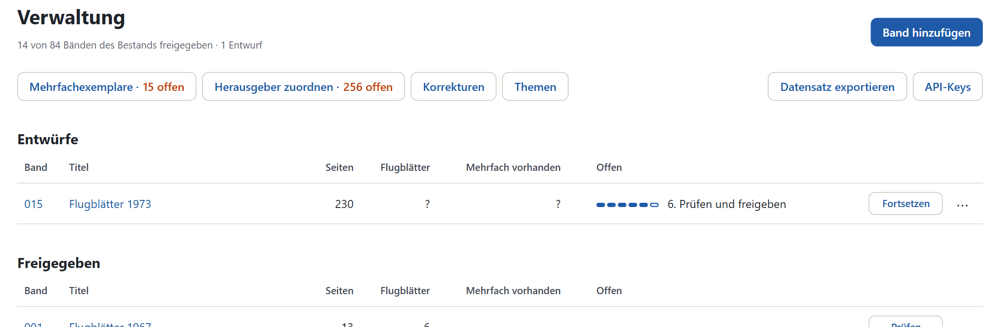
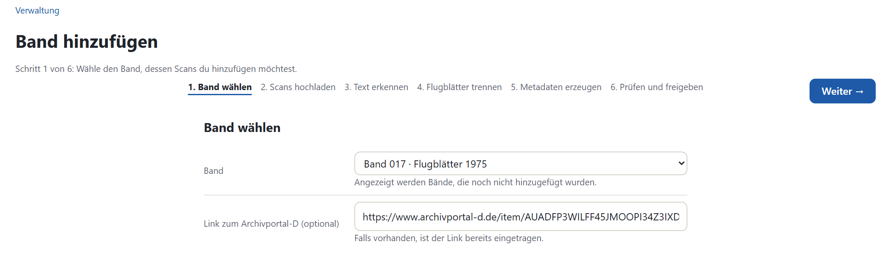
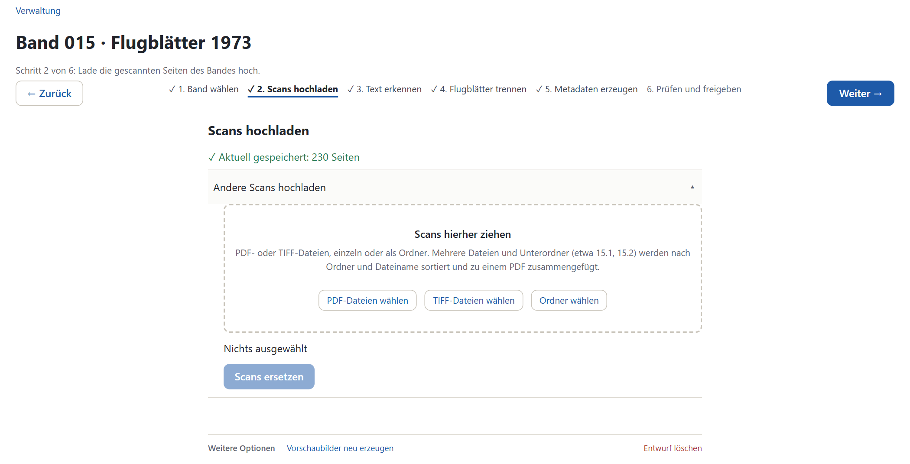
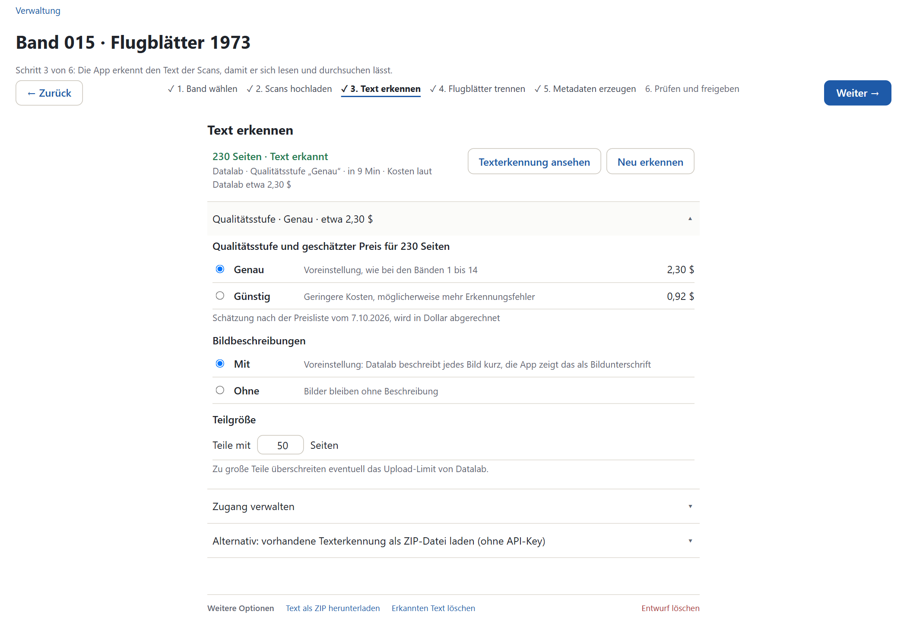
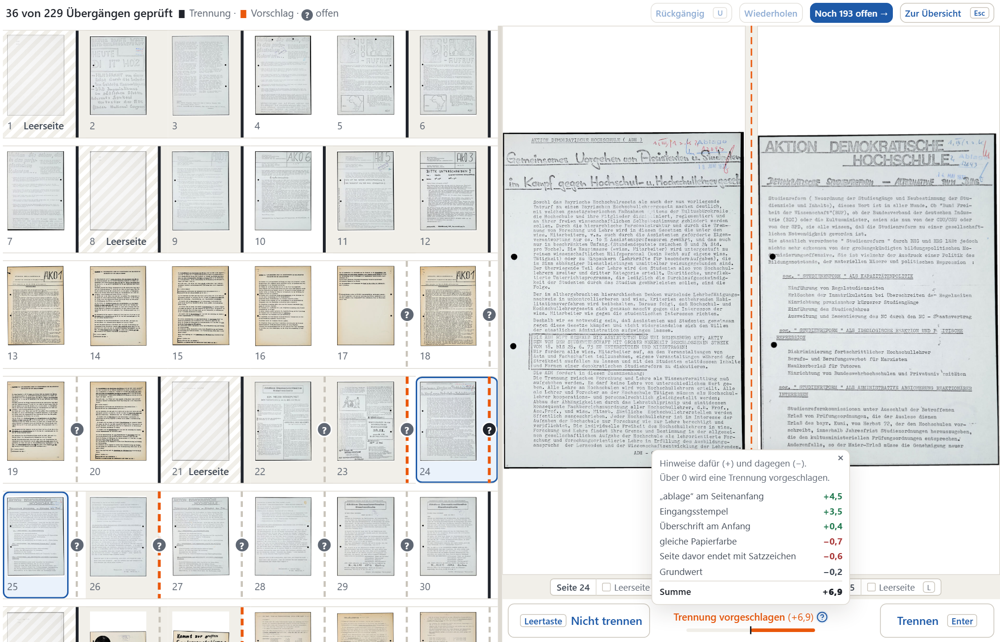
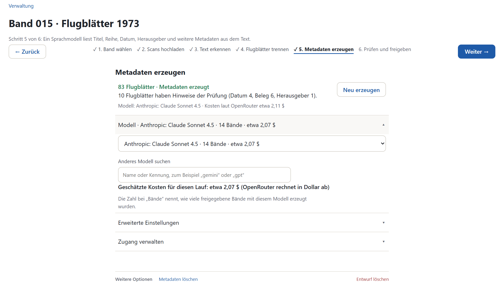
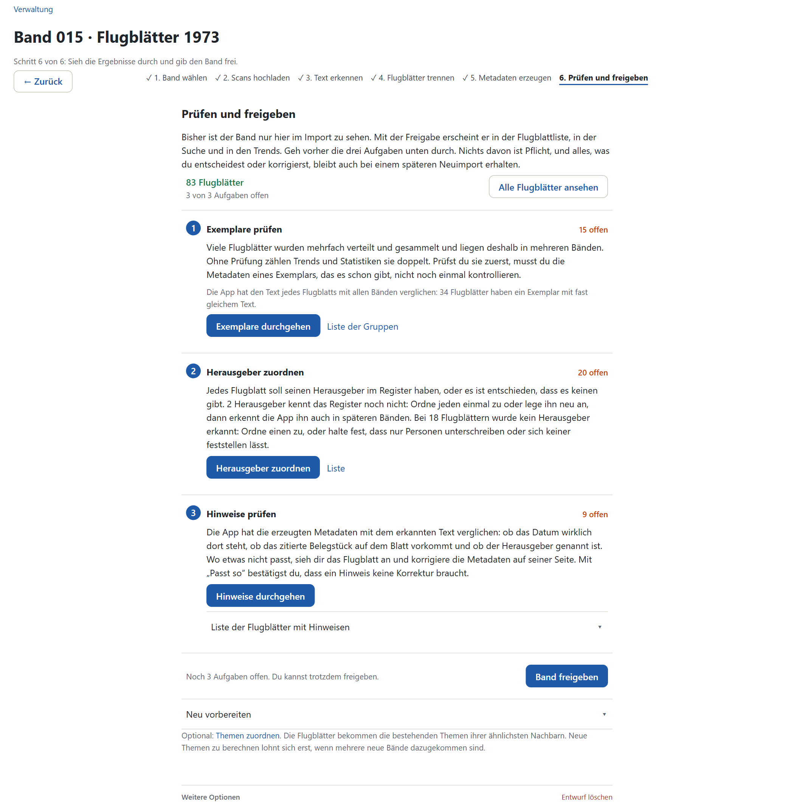
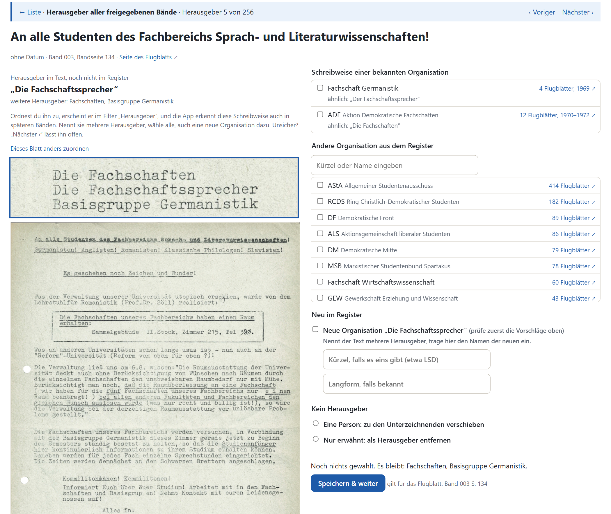
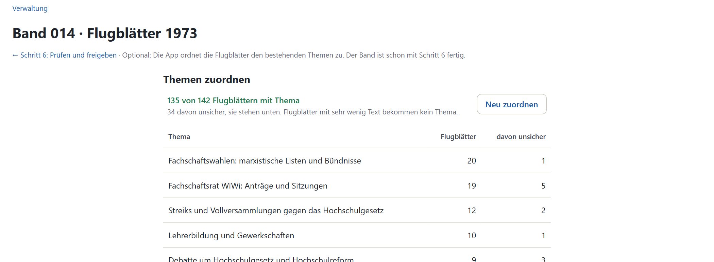

# Neue Bände importieren

Diese Anleitung führt durch den Import eines Bandes in der Anwendung, vom Scan bis zur Freigabe. Die Abbildungen stammen aus einem Testimport mit 230 Seiten, der in der App als Band 015 angelegt ist. Er gehört nicht zum Korpus des Projekts. Schritt 1 zeigt die Auswahl eines neuen Bandes, „Themen zuordnen“ das Ergebnis von Band 014.

## Überblick

| Schritt | Was die App tut | Was Sie tun | Dauer | Kosten je 100 Seiten |
|---|---|---|---|---|
| 1. Band wählen | legt den Band als Entwurf an | Band aus der Liste wählen | Sekunden | – |
| 2. Scans hochladen | fügt PDF- oder TIFF-Dateien zu einem PDF zusammen | Dateien oder Ordner wählen | Minuten, je nach Größe | – |
| 3. Text erkennen | schickt die Seiten an Datalab | starten und warten | etwa 4 Minuten | 1,00 $ |
| 4. Flugblätter trennen | schlägt vor, wo ein Flugblatt endet | jeden Seitenwechsel prüfen | 7 bis 11 Sekunden je Seite, also 12 bis 18 Minuten | – |
| 5. Metadaten erzeugen | lässt ein Sprachmodell Titel, Datum, Herausgeber usw. lesen | starten und warten | einige Minuten | etwa 0,90 $ |
| 6. Prüfen und freigeben | findet Mehrfachexemplare, unbekannte Herausgeber und Unstimmigkeiten | drei Aufgaben durchgehen, dann freigeben | etwa 1,5 Minuten je Mehrfachexemplar, dazu Herausgeber und Hinweise | – |
| danach: Themen zuordnen | ordnet die Flugblätter den bestehenden Themen zu | starten | wenige Minuten | unter 1 Cent je Band |

Die Kosten sind am Testimport gemessen (Texterkennung 2,30 $ in 9 Minuten, Metadaten 2,11 $ für 230 Seiten). Die Zeiten für das Trennen und die Mehrfachexemplare stammen aus der Arbeit an den Bänden 1 bis 14 ([Kapitel 12](../bericht/12-projektverlauf.md)).

Bis zur Freigabe ist der Band ein Entwurf: Er fehlt in Flugblattliste, Suche, Trends und Themen. Jeder Schritt speichert sein Ergebnis. Sie können die Seite jederzeit schließen und später über Verwaltung › „Fortsetzen“ weitermachen.



In der Verwaltung steht jeder Entwurf mit seinem Stand: Die sechs Striche sind die Schritte, daneben steht der aktuelle. Das Menü ⋯ am Zeilenende enthält „Entwurf löschen“.

## Voraussetzungen

- Die Anwendung läuft (siehe [Installieren und betreiben](installieren-und-betreiben.md)).
- Für Schritt 3 ein API-Key von [Datalab](https://www.datalab.to), für Schritt 5 und die Themen einer von [OpenRouter](https://openrouter.ai). Eintragen unter Verwaltung › API-Keys oder direkt im Schritt unter „Zugang verwalten“. Beide Dienste rechnen in Dollar über Ihr Konto ab. Setzen Sie dort ein Ausgabenlimit.
- Die Scans liegen als PDF oder als TIFF-Dateien vor.

## 1. Band wählen



1. Verwaltung › „Band hinzufügen“.
2. Den Band in der Liste wählen. Sie enthält die Bände aus dem Findmittel, die noch nicht hinzugefügt sind.
3. Den Link zum Archivportal-D prüfen. Ist er bekannt, steht er schon im Feld. Er lässt sich später in Schritt 1 ändern.
4. „Weiter →“.

## 2. Scans hochladen



1. Die Scans in das gestrichelte Feld ziehen oder über „PDF-Dateien wählen“, „TIFF-Dateien wählen“ oder „Ordner wählen“ auswählen.
2. Liegt ein Band in mehreren Ordnern (etwa 15.1, 15.2), wählen Sie den Ordner darüber. Die App sortiert nach Ordner und Dateiname. Andere Dateien im Ordner, etwa `Thumbs.db`, lässt sie weg.
3. Unter dem Feld steht, was ausgewählt ist. „Hochladen“.
4. Nach dem Zusammenfügen steht oben „Aktuell gespeichert: N Seiten“. Vergleichen Sie die Zahl mit dem Band.

Falsche Scans ersetzen Sie über „Andere Scans hochladen“. Der erkannte Text gehört zum alten Scan und wird dabei gelöscht, die Texterkennung kostet dann erneut.

## 3. Text erkennen



1. Die Qualitätsstufe prüfen. Voreingestellt ist „Genau“, wie bei den Bänden 1 bis 14. „Günstig“ kostet etwa 40 % davon (0,40 statt 1,00 $ je 100 Seiten), macht aber möglicherweise mehr Fehler. Der geschätzte Preis steht bei jeder Stufe.
2. Bildbeschreibungen und Teilgröße bleiben auf der Voreinstellung.
3. „Texterkennung starten“. Die App schickt die Seiten in Teilen an Datalab. Der Fortschritt steht unter dem Knopf. Die Seite darf geschlossen werden.
4. Danach steht dort „N Seiten · Text erkannt“ mit Dauer und Kosten laut Datalab.
5. „Texterkennung ansehen“ zeigt Scan und erkannten Text Seite für Seite nebeneinander. Sehen Sie sich einige Seiten an.

Ohne Datalab-Key lässt sich eine vorhandene Texterkennung als ZIP laden („Alternativ: vorhandene Texterkennung als ZIP-Datei laden“). Unter „Weitere Optionen“ › „Text als ZIP herunterladen“ sichern Sie das bezahlte Ergebnis.

## 4. Flugblätter trennen

Im Scan liegen alle Flugblätter des Bandes hintereinander. Hier legen Sie fest, wo eines endet und das nächste beginnt. Erst danach lässt sich jedes Flugblatt einzeln beschreiben und zählen.

Beim ersten Öffnen bietet der Schritt drei Wege an:

| Knopf | Wann |
|---|---|
| „Vorschlagen lassen“ | Normalfall. Die App setzt Trennungen nach Stempel, Datum, Papier und Lochung, Sie prüfen jede. |
| „Liste laden“ | Die Einteilung liegt schon als Textdatei vor, eine Zeile je Flugblatt (Beispiel in der App). |
| „Von Hand trennen“ | ohne Vorschlag, jede Trennung selbst setzen |

Der Vorschlag liegt etwa bei jedem achten Seitenwechsel falsch ([Kapitel 4.5](../bericht/04-trennen.md#45-qualitat-des-neuen-verfahrens)). Deshalb prüfen Sie jeden.

### Die Trennansicht



Links stehen alle Seiten, rechts groß die beiden Seiten am gewählten Seitenwechsel. Die Seiten eines Flugblatts haben links dieselbe Hintergrundfarbe.

| Zeichen | Bedeutung |
|---|---|
| schwarzer Strich | Trennung: Hier beginnt ein neues Flugblatt. |
| oranger Strich | vorgeschlagene Trennung |
| grau gestrichelt | keine Trennung vorgeschlagen |
| ? am Strich | Seitenwechsel noch nicht geprüft |
| kein Strich | geprüft: Die Seiten gehören zusammen. |
| schraffiert, „Leerseite“ | Seite gehört zu keinem Flugblatt |

Unten steht der Wert des Vorschlags. Über 0 schlägt die App eine Trennung vor. Das Fragezeichen daneben zeigt, woraus sich der Wert zusammensetzt.

| Taste | Wirkung |
|---|---|
| Leertaste | nicht trennen |
| Enter | trennen |
| ← → | voriger / nächster Seitenwechsel |
| Shift+L / L | linke / rechte Seite ist leer |
| U oder Strg+Z | rückgängig |
| Strg+Y | wiederholen |
| Esc | zur Übersicht |

Die App speichert laufend. „Noch N offen →“ springt zum nächsten ungeprüften Seitenwechsel. Sind alle geprüft, heißt der Knopf „Einteilung abschließen“. Erst danach geht es weiter zu Schritt 5.

### Woran Sie ein neues Flugblatt erkennen

- oben rechts der Eingangsstempel des Archivs, oft mit einem blauen „F“,
- oben eine neue Überschrift, Kopfleiste oder ein Datum,
- unten auf der Seite davor ein Impressum: „Verantwortlich: …“, „V. i. S. d. P.“, „Eigendruck im Selbstverlag“,
- Löcher vom Abheften am linken Rand,
- ein anderes Papier: andere Farbe oder anderes Format.

Dasselbe Flugblatt geht meist weiter, wenn die Löcher am rechten Rand sitzen (die Rückseite), oben eine Seitenzahl wie „- 2 -“ steht, der Text mitten im Satz einsetzt oder unten auf der Seite davor „b. w.“ steht. Hefte und Pressespiegel bleiben ein Flugblatt. Im Zweifel nicht trennen. Die Regeln für Grenzfälle stehen in [Kapitel 4.2](../bericht/04-trennen.md#42-herausforderungen) des Berichts.

## 5. Metadaten erzeugen



1. Das Modell prüfen. Voreingestellt ist das Modell, mit dem die meisten freigegebenen Bände erzeugt wurden („14 Bände“). Behalten Sie es, damit die Metadaten mit denen der anderen Bände vergleichbar bleiben. Die geschätzten Kosten stehen unter der Auswahl.
2. „Metadaten erzeugen“. Das dauert einige Minuten. Die Seite darf geschlossen werden.
3. Danach steht dort die Zahl der Flugblätter und wie viele Hinweise der Prüfung haben (Datum, Beleg, Herausgeber). Diese Hinweise gehen Sie in Schritt 6 durch.

Zu jedem Feld gibt das Sprachmodell die Stelle im Text als Beleg an. Unter „Erweiterte Einstellungen“ stehen der Prompt und die Batchgröße. Ändern Sie sie nur mit gutem Grund: Der Prompt gilt für alle späteren Bände. „Zurücksetzen“ stellt ihn wieder her.

Ändern Sie danach die Einteilung in Schritt 4, müssen die Metadaten neu erzeugt werden. Flugblätter mit denselben Seiten übernimmt die App dabei kostenlos, wenn das Modell gleich bleibt.

## 6. Prüfen und freigeben

Beim ersten Öffnen bereitet die App die Flugblätter etwa eine halbe Minute lang vor. Dann stehen dort drei Aufgaben. Keine ist Pflicht. Was Sie entscheiden oder korrigieren, bleibt auch bei einem späteren Neuimport erhalten.



| Aufgabe | Worum es geht | Was Sie tun |
|---|---|---|
| Exemplare prüfen | Flugblätter, die es mit fast gleichem Text schon in einem anderen Band gibt. Ungeprüft zählen Trends und Statistiken sie doppelt. | „Exemplare durchgehen“. Je Gruppe entscheiden: „Als geprüft speichern“ oder „Das sind verschiedene Flugblätter“; bei Bedarf „Zum Hauptexemplar machen“. |
| Herausgeber zuordnen | Herausgeber, die das Register noch nicht kennt, und Flugblätter ohne erkannten Herausgeber | „Herausgeber zuordnen“, siehe unten |
| Hinweise prüfen | Datum, Beleg oder Herausgeber stehen nicht so im erkannten Text. | „Hinweise durchgehen“. Auf der Seite des Flugblatts „Metadaten korrigieren“ oder „Passt so“, dann „Nächster Hinweis ›“. |

Gehen Sie die Exemplare zuerst durch. Bei einem Exemplar, das es schon gibt, müssen Sie die Metadaten nicht noch einmal prüfen.

### Herausgeber zuordnen



Links steht die Schreibweise aus dem Text mit dem Ausschnitt im Scan, rechts die Auswahl. Das Bild zeigt die Prüfung über alle freigegebenen Bände (Verwaltung › Herausgeber zuordnen); aus Schritt 6 heraus sieht die Seite gleich aus.

- **Schreibweise einer bekannten Organisation:** Die App schlägt ähnlich geschriebene Organisationen vor.
- **Andere Organisation aus dem Register:** Kürzel oder Namen eingeben. Nennt das Flugblatt mehrere Herausgeber, wählen Sie alle.
- **Neu im Register:** legt die Organisation neu an.
- **Kein Herausgeber:** Bei einer Person „zu den Unterzeichnenden verschieben“. Ist die Organisation nur erwähnt, „als Herausgeber entfernen“.

„Speichern & weiter“ übernimmt die Auswahl. Ordnen Sie eine Schreibweise genau einer Organisation zu, erkennt die App sie auch in späteren Bänden. „Nächster ›“ lässt den Herausgeber offen. Bei Flugblättern ganz ohne Herausgeber halten Sie fest, dass nur Personen unterschreiben oder dass sich keiner feststellen lässt.

### Freigeben

„Band freigeben“. Danach erscheint der Band in Flugblattliste, Suche und Trends. Offene Aufgaben lassen sich auch nach der Freigabe erledigen: Verwaltung › „Prüfen“ führt wieder zu Schritt 6.

Die Schritte 1 bis 5 sind nach der Freigabe gesperrt. Zum Ändern „Freigabe zurücknehmen“ (in Schritt 6 oder im Menü ⋯ der Verwaltung). Bis zur neuen Freigabe fehlt der Band dann in Liste, Suche und Trends.

„Neu vorbereiten“ übernimmt die Flugblätter noch einmal aus Schritt 5 und sucht die Exemplare neu, etwa nachdem in einem anderen Band Exemplare geprüft wurden. Korrekturen und Entscheidungen bleiben erhalten.

## Danach: Themen zuordnen

Optional, auch nach der Freigabe. „Themen zuordnen“ gibt jedem Flugblatt das Thema, das unter seinen fünf ähnlichsten Flugblättern überwiegt, und einen Punkt auf der Themenkarte. Braucht den OpenRouter-Key; kostet weniger als einen Cent je Band. Beim ersten Mal holt die App auch die Embeddings aller freigegebenen Flugblätter (etwa 2 Cent, einige Minuten).



Danach zeigt der Schritt eine Tabelle der Themen mit der Zahl der Flugblätter und der unsicheren, darunter die unsicher zugeordneten Flugblätter mit Link. Flugblätter mit sehr wenig Text bekommen kein Thema, bei Band 014 sind das 7 von 142. Neue Themen entstehen hier nicht. Unter Verwaltung › Themen ist vermerkt, dass der Band nachträglich zugeordnet wurde; nach mehreren neuen Bänden lohnt es sich, die Themen neu zu berechnen ([Installieren und betreiben](installieren-und-betreiben.md#themen-neu-berechnen)).

## Ohne Weboberfläche

Dieser Abschnitt ist für alle, die mit Docker und der Kommandozeile vertraut sind. Jeder Schritt lässt sich auch dort ausführen, im laufenden Container:

```bash
docker compose exec backend python -m app.cli --help
docker compose exec backend python -m app.cli trennen --help   # Optionen eines Schritts
```

Ein ganzer Band, hier Nr. 16. Die Dateien müssen im Container liegen. `/data/pdfs` ist dort der Scan-Ordner, den `LEAFLET_PDF_HOST_DIR` in `.env` angibt: Was Sie auf Ihrem Rechner in diesen Ordner legen, sieht der Container unter `/data/pdfs`.

```bash
docker compose exec backend python -m app.cli band 16
docker compose exec backend python -m app.cli scans 16 /data/pdfs/neu/0118_0016.pdf
docker compose exec backend python -m app.cli ocr 16                       # --stufe balanced („Günstig“), --zip ERGEBNIS.zip
docker compose exec backend python -m app.cli trennen 16 --vorschlag       # oder --liste /data/pdfs/neu/liste.txt
docker compose exec backend python -m app.cli trennen 16                   # gespeicherte Trennungen bestätigen
docker compose exec backend python -m app.cli angaben 16                   # --modell anthropic/claude-sonnet-4.5
docker compose exec backend python -m app.cli anlegen 16                   # Flugblätter für Schritt 6 vorbereiten
docker compose exec backend python -m app.cli freigeben 16
docker compose exec backend python -m app.cli themen 16
docker compose exec backend python -m app.cli status
```

Die Befehle prüfen dasselbe wie die App und nennen vor kostenpflichtigen Schritten den geschätzten Preis. Laufende Schritte zeigen ihren Fortschritt; Strg+C hält Texterkennung und Metadaten nach dem laufenden Teil an, fertige Teile bleiben erhalten. `themen-neu`, `themen-uebernehmen` und `themen-verwerfen` entsprechen „Themen neu berechnen“ unter Verwaltung › Themen; übernommen werden dabei die Titel des Sprachmodells, umbenennen lassen sie sich danach in der App.

Nur in der Weboberfläche gehen die Durchsicht der Trennungen am Bild und die drei Aufgaben in Schritt 6 (Exemplare, Herausgeber, Hinweise). Die App weiß nichts von einem Lauf in der Kommandozeile: Denselben Band nicht gleichzeitig in beiden bearbeiten. Zeigt die App danach einen alten Stand, hilft `docker compose restart backend`.

## Wenn etwas schiefgeht

Am Ende jedes Schritts stehen unter „Weitere Optionen“ die Knöpfe zum Zurücksetzen dieses Schritts und „Entwurf löschen“.

| Problem | Lösung |
|---|---|
| Der Startknopf ist grau, daneben „Speichere zuerst deinen API-Key“. | Key unter „Zugang verwalten“ im Schritt oder unter Verwaltung › API-Keys eintragen. |
| Texterkennung oder Metadaten wurden unterbrochen (Abbrechen, Neustart der App, Netzfehler). | Der Schritt zeigt „Unterbrochen“. „Fortsetzen“ fragt nur die fehlenden Teile an, fertige sind bezahlt und bleiben. Nach „Abbrechen“ werden Teile, die schon an Datalab gesendet sind, noch fertig und berechnet. |
| Seiten werden falsch oder gar nicht angezeigt. | Schritt 2 › Weitere Optionen › „Vorschaubilder neu erzeugen“. |
| Falsche oder unvollständige Scans | Schritt 2 › „Andere Scans hochladen“. |
| Der Trennvorschlag passt bei einem ungewöhnlichen Scan schlecht. | Schritt 4 › Weitere Optionen › „Nur aus dem Text vorschlagen“. Papier, Lochung und Stempel zählen dann nicht. |
| Die Einteilung soll ganz neu beginnen. | Schritt 4 › Weitere Optionen › „Einteilung löschen“. Das löscht auch die von Hand gesetzten Trennungen. |
| Schritt 5 meldet, dass sich die Einteilung geändert hat. | „Metadaten erzeugen“ erneut. Unveränderte Flugblätter übernimmt die App ohne Kosten. |
| Das bisherige Modell gibt es bei OpenRouter nicht mehr. | Schritt 5 weist darauf hin. Ein möglichst ähnlich starkes Modell wählen. |
| Ein freigegebener Band enthält Fehler in Schritt 1 bis 5. | „Freigabe zurücknehmen“, korrigieren, wieder freigeben. Einzelne Metadaten korrigieren Sie ohne Zurücknehmen auf der Seite des Flugblatts. |
| Alles soll von vorn beginnen. | „Entwurf löschen“. Scans, Text und Metadaten des Entwurfs gehen verloren, der Band im Archiv bleibt unberührt. |
