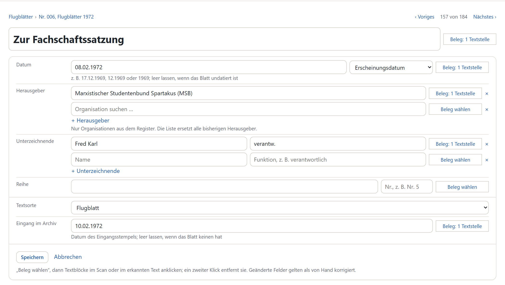
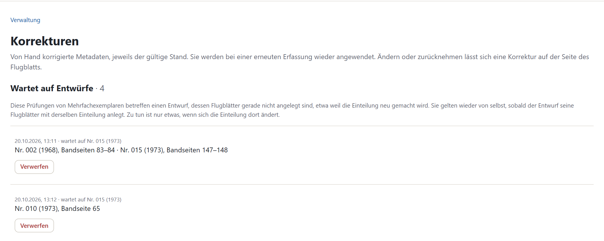
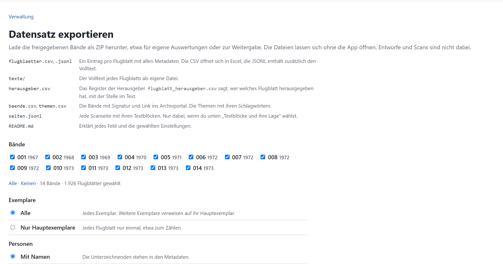

# Pflege

Diese Anleitung beschreibt, wie Sie den Bestand pflegen: Metadaten korrigieren, Mehrfachexemplare prüfen, Herausgeber zuordnen, Themen bearbeiten und exportieren. **Verwaltung** rechts oben führt zu diesen Aufgaben, Metadaten korrigieren Sie direkt auf der Seite eines Flugblatts.

Was Sie in der Anwendung korrigieren oder entscheiden, speichert sie in eigenen Dateien in `data/`, getrennt von den automatisch erzeugten Metadaten. Es bleibt deshalb erhalten, wenn die Datenbank neu aufgebaut oder ein Band neu eingelesen wird ([Installation und Betrieb › Datensicherung](installieren-und-betreiben.md#datensicherung)).

## Metadaten korrigieren

1. Auf der Seite des Flugblatts „Metadaten korrigieren“.
2. Felder ändern. Herausgeber wählen Sie aus dem Register („Organisation suchen …“). Fehlt eine Organisation, legen Sie sie über [Herausgeber zuordnen](#herausgeber-zuordnen) an.
3. Zu einer geänderten Angabe „Beleg wählen“ und die Textblöcke im Scan oder im erkannten Text anklicken. Ein zweiter Klick entfernt einen Block.
4. „Speichern“.

Geänderte Felder tragen danach den Hinweis „von Hand korrigiert“. „Alle Handkorrekturen entfernen“ stellt die automatisch erkannten Metadaten wieder her. Eine Korrektur gilt für das Flugblatt mit genau diesen Seiten. Ändert sich später die Trennung, erscheint sie unter [Korrekturen](#korrekturen-im-uberblick) zum Prüfen.

Beim Import zeigt die App Flugblätter mit Prüfhinweisen. Auf ihrer Seite bestätigt „Passt so“, dass ein Hinweis keine Korrektur braucht.

## Mehrfachexemplare prüfen

Viele Flugblätter liegen in mehreren Exemplaren im Bestand. Die App hat Exemplare mit fast gleichem Text zu Gruppen zusammengefasst. Ungeprüft zählen sie in Trends und Statistiken mehrfach.

Verwaltung › „Mehrfachexemplare“ listet alle Gruppen mit ihrem Stand. „Ungeprüfte durchgehen →“ führt durch die offenen.

1. Die Exemplare stehen nebeneinander, Abweichungen in den Metadaten sind farbig markiert. Ganz unten stehen Text und Scan der Exemplare im Vergleich.
2. Wählen Sie bei dem Exemplar mit den richtigsten Metadaten, dem besten Scan und dem vollständigsten Text „Hauptexemplar“. Es vertritt alle Exemplare in Liste, Trends und Export.
3. Gehört ein Blatt nicht zur Gruppe, haken Sie „gehört nicht dazu“ an. Sind es lauter verschiedene Flugblätter, „Das sind verschiedene Flugblätter“.
4. Unter „Gemeinsame Metadaten“ korrigieren Sie die Metadaten für alle Exemplare. Sagt ein anderes Exemplar etwas anderes, steht sein Wert darunter. „übernehmen“ setzt ihn ein.
5. „Speichern & weiter“ springt zur nächsten ungeprüften Gruppe.

„Prüfung zurücknehmen“ macht eine Gruppe wieder ungeprüft.

## Herausgeber zuordnen

Verwaltung › „Herausgeber zuordnen“ listet über alle freigegebenen Bände die Flugblätter, deren Herausgeber das Register noch nicht kennt („Offen“), und die ohne erkannten Herausgeber („Ohne Herausgeber“). Die Zuordnung funktioniert wie in Schritt 6 des Imports, siehe [Herausgeber zuordnen](neue-baende-importieren.md#herausgeber-zuordnen).

## Korrekturen im Überblick

Verwaltung › „Korrekturen“ zeigt alle Handkorrekturen: je Flugblatt das Feld, den automatisch erkannten und den korrigierten Wert und das Datum. Die Knöpfe oben filtern nach Feld, „Band“ nach Band. Ein Klick auf den Titel öffnet das Flugblatt, „← Korrekturen“ führt zurück.

Passt eine Korrektur oder Exemplar-Prüfung nicht mehr zu den Seiten, weil sich die Trennung geändert hat, steht sie hier getrennt. Sie lässt sich verwerfen oder für die neuen Seiten neu prüfen.

## Themen

### Themen umbenennen

Verwaltung › „Themen“ › „Bearbeiten“ ändert den Titel eines Themas. Neue Bände ordnen Sie über [Themen zuordnen](neue-baende-importieren.md#nach-der-freigabe-themen-zuordnen) zu.

### Themen neu berechnen

Unter Verwaltung › Themen › „Themen neu berechnen“. Braucht den OpenRouter-Key; die Berechnung läuft einige Minuten im Hintergrund.

1. Höchstzahl der Themen und Sprachmodell für die Titel wählen, „Themen neu berechnen“. Voreingestellt sind die Zahl der jetzigen Themen und das Modell der bisherigen Titel. Die geschätzten Kosten stehen beim Modell. Die Ähnlichkeit berechnet immer bge-m3.
2. Das Ergebnis liegt als `data/topics.kandidat.json` und `data/topic_map.kandidat.json` neben den bisherigen Dateien und ist noch nicht in Gebrauch.
3. Auf der Prüfseite die Titel durchgehen. In den Feldern stehen die Vorschläge des Sprachmodells. Je Thema steht darunter, aus welchem bisherigen Thema die meisten Flugblätter stammen; „… Flugblätter“ öffnet sie in der Flugblattliste.
4. „Neue Einteilung übernehmen“ ersetzt `topics.json` und `topic_map.json`; die alten Dateien bleiben als `topics.bis-<Zeit>.json` und `topic_map.bis-<Zeit>.json`. „Neuberechnung verwerfen“ löscht nur den Kandidaten.
5. Entwürfe danach mit „Themen zuordnen“ neu zuordnen.

Fehlt das bisherige Titelmodell bei OpenRouter, ist das stärkste Modell vorausgewählt, das für den Lauf höchstens etwa 0,10 $ kostet. Scheitern zu viele Titelanfragen, bricht der Lauf ab, statt Schlüsselwörter als Titel zu liefern.

Die Embeddings speichert die Anwendung in `data/embeddings.bge-m3.npz`; ein zweiter Lauf fragt nur neue Texte an. Das Image enthält dafür BERTopic, UMAP, HDBSCAN und das spaCy-Modell `de_core_news_lg` und ist dadurch etwa 1,5 GB groß.

## Exportieren

Verwaltung › „Datensatz exportieren“ lädt die freigegebenen Bände als ZIP. Die Dateien lassen sich ohne die Anwendung öffnen, die CSV-Dateien etwa in Excel. Entwürfe und Scans sind nicht dabei.

1. Bände wählen.
2. **Exemplare:** „Alle“ oder „Nur Hauptexemplare“, etwa zum Zählen.
3. **Personen:** „Mit Namen“ oder „Ohne Namen“. Ohne Namen fehlen die Unterzeichnenden in den Metadaten, im Volltext stehen sie weiterhin. Nach Auskunft des Universitätsarchivs (Dr. Andreas Becker, Oktober 2026) darf der Datensatz auch mit Namen weitergegeben werden.
4. Unter „Zusätzlich“ auf Wunsch die Textblöcke jeder Scanseite mit ihrer Lage (`seiten.jsonl`).
5. „ZIP erstellen“.

Das ZIP enthält eine `README.md`, die jedes Feld erklärt. Die Felder beschreibt auch [Kapitel 9](../bericht/09-anwendung.md).
