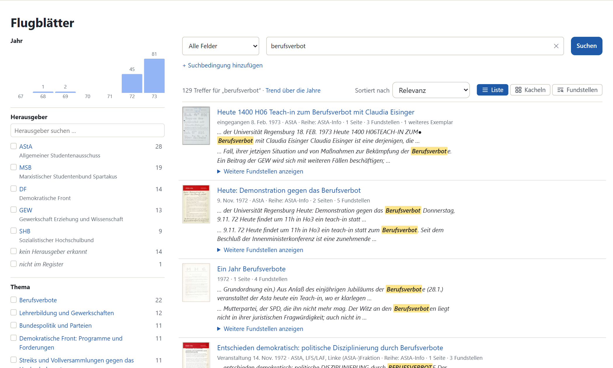
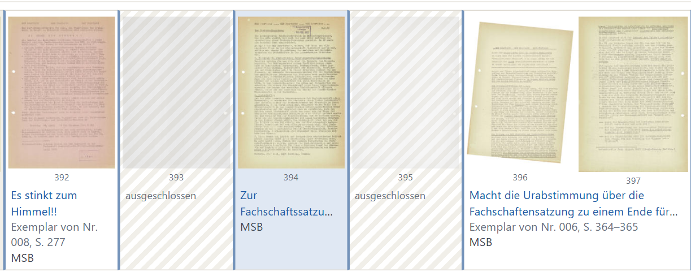
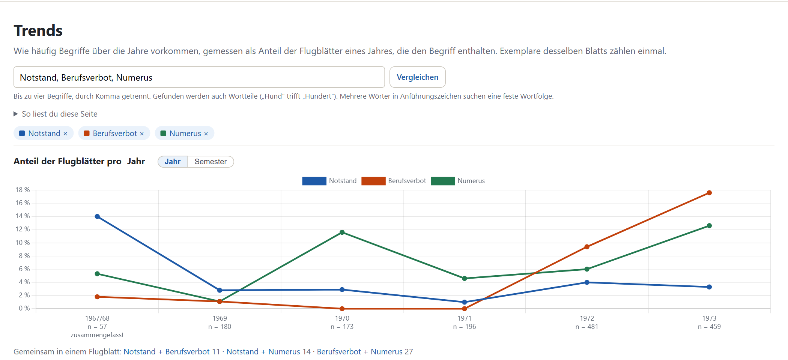

# Recherche

Diese Anleitung beschreibt, wie Sie im Bestand suchen und lesen. Wie Sie Metadaten korrigieren und den Bestand pflegen, steht in [Pflege](pflegen.md), wie ein neuer Band dazukommt, in [Import neuer Bände](neue-baende-importieren.md).

Die Leiste oben führt zu Flugblättern, Herausgebern, Bänden, Themen und Trends; das Suchfeld steht auf jeder Seite.

## Suchen und filtern

Das Suchfeld oben auf jeder Seite durchsucht Titel, Reihe, Herausgeber, Unterzeichnende und den erkannten Text aller freigegebenen Flugblätter.

- Die Suche findet auch Wortteile: „versammlung“ trifft „Vollversammlung“ und, trotz Lesefehler, „Vo11versammlung“.
- Mehrere Wörter müssen alle vorkommen. Wörter in Anführungszeichen suchen eine feste Wortfolge.
- „daß“ und „dass“ finden sich gegenseitig.
- Begriffe unter drei Zeichen sucht die App nur in Titel und Reihe.
- Über „Alle Felder“ lässt sich die Suche auf ein Feld beschränken. „+ Suchbedingung hinzufügen“ verknüpft mehrere Bedingungen mit UND, ODER oder NICHT.

Links stehen die Filter: Jahr, Herausgeber, Thema, Datierung, Textsorte und Reihe. Die Zahl neben jedem Wert nennt die Treffer mit diesem Wert. Mehrere Filter grenzen gemeinsam ein. Als Jahr zählt das Datum auf dem Blatt, bei undatierten Blättern das Jahr des Bandes.

Über der Liste lassen sich die Sortierung und die Ansicht wählen: **Liste** mit Textausschnitten, **Kacheln** und, wenn ein Suchbegriff eingegeben ist, **Fundstellen**: alle Textstellen aller Treffer untereinander, nach Datum. „Trend über die Jahre“ öffnet die Suche in den Trends. Unter der Liste lädt ein Link alle Treffer als CSV-Tabelle (Titel, Datum, Herausgeber, Thema und Link, ohne Volltext).

Ein Flugblatt, das in mehreren Exemplaren im Bestand liegt, steht nur einmal in der Liste, mit dem Hinweis „1 weiteres Exemplar“. Unter „Mehrfach vorhandene Blätter“ › „Jedes Exemplar einzeln zeigen“ erscheinen alle.

## Ein Flugblatt lesen

Oben stehen die Metadaten. Ein Klick auf „Beleg“ zeigt die Textstelle im Scan, auf die sich eine Angabe stützt. Darunter steht für jede Seite der erkannte Text neben dem Scan. „Vergrößern“ öffnet den Scan in voller Auflösung.

| Taste oder Link | Wirkung |
|---|---|
| ← → | vorige / nächste Seite des Flugblatts |
| 1 bis 9 | zur Seite mit dieser Nummer |
| „‹ Voriges“, „Nächstes ›“ | voriges / nächstes Flugblatt der Liste, aus der Sie gekommen sind |

## Übersichten

- **Bände** listet alle Bände des Bestands wie im Findmittel. Die Seite eines Bandes zeigt seine Scanseiten der Reihe nach, nach Flugblättern gruppiert, und den Link ins Archivportal-D.

  

- **Herausgeber** ist das Register der Organisationen. Die Seite einer Organisation zeigt ihre Flugblätter, den Verlauf über die Jahre, die häufigsten Themen und mit wem sie gemeinsam herausgegeben hat.
- **Themen** zeigt die Themen mit ihren Schlüsselwörtern, der Zahl der Flugblätter und der Verteilung über die Jahre, dazu die Themenkarte: Jeder Punkt ist ein Flugblatt, ähnliche Texte liegen nah beieinander. Wie die Themen entstanden sind, steht in [Kapitel 7](../bericht/07-themen.md).

  

## Trends

Die Trends zeigen, welcher Anteil der Flugblätter eines Jahres einen Begriff enthält. Exemplare desselben Flugblatts zählen einmal.

1. Bis zu vier Begriffe durch Komma getrennt eingeben, „Vergleichen“. Auch hier zählen Wortteile, Wörter in Anführungszeichen suchen eine feste Wortfolge.
2. „Jahr“ oder „Semester“ wählen. Jahre mit weniger als 20 Flugblättern sind mit dem folgenden zusammengefasst (im Bild 1967/68). Unter jedem Jahr steht die Zahl der Flugblätter (n).
3. Darunter steht, wie oft die Begriffe gemeinsam in einem Flugblatt vorkommen, und je Begriff ein Reiter mit den getroffenen Wortformen und dem Link „Alle … Flugblätter anzeigen“.

Die Kurven zeigen, was im Bestand liegt, nicht, wie viel damals diskutiert wurde. „So liest du diese Seite“ erklärt das in der App.
